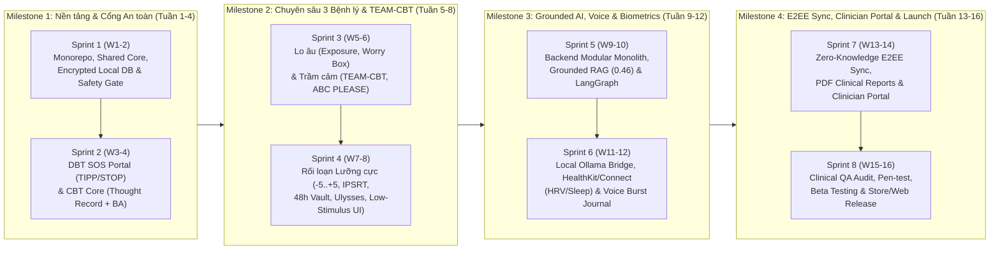

# KẾ HOẠCH TRIỂN KHAI CHI TIẾT (DETAILED IMPLEMENTATION PLAN)
## Hệ sinh thái Ứng dụng Đa nền tảng CBT & DBT (Flutter + TypeScript / Next.js + Modular Backend)
**Tài liệu tham chiếu:** [SPEC.md](file:///d:/NC2026/cognitive-toolkit/SPEC.md)  
**Tổng thời lượng dự kiến:** 16 Tuần (8 Sprint × 2 Tuần) — Chia làm 4 Mốc bàn giao (Milestones) độc lập, có thể kiểm thử và phát hành theo từng giai đoạn.

---

## 1. CHIẾN LƯỢC TRIỂN KHAI & QUY TẮC KIẾN TRÚC

1. **Local-First & Zero-Latency trước, Cloud AI & Sync sau:**
   - Giai đoạn 1–2 xây dựng hoàn chỉnh lõi **CBT & DBT Deterministic Engine** hoạt động 100% offline trên cả **Flutter (Android/iOS)** và **TypeScript Web (PWA)**. Người dùng có thể mở App là dùng được ngay Cổng SOS, Thought Record, Behavioral Activation, Biểu đồ Lưỡng cực mà không cần Internet hay API Key.
2. **Single Source of Truth cho Dữ liệu & Phác đồ Lâm sàng:**
   - Mọi phác đồ CBT/DBT (`thought-record`, `tipp`, `opposite-action`, `behavioral-activation`, `wise-mind`, `chain-analysis`, `dear-man`, `worry-box`, `abc-please`, `crisis-pros-cons`, `hypomania-guard`) được định nghĩa chuẩn hóa dưới dạng JSON/YAML/Markdown trong `packages/clinical-protocols-kb/`.
   - Schema dữ liệu (Zod/OpenAPI) sinh đồng bộ cho cả TypeScript và Dart (`freezed` / `drift`).
3. **An toàn Lâm sàng là Điều kiện Tiên quyết (Safety-First Gate):**
   - Không merge bất kỳ PR nào nếu không vượt qua bộ kiểm thử tự động **Clinical Safety Test Suite** (Safety Stop, Medical Screening cho TIPP Nước lạnh, Accuracy Check, Rest Check, Hard Stops cho Chain Analysis, và Hypomania Guard chống Manic Switch).

---

## 2. SƠ ĐỒ TIẾN ĐỘ TỔNG THỂ (16 TUẦN / 8 SPRINTS)

---

## 3. KẾ HOẠCH CHI TIẾT TỪNG SPRINT (WORK BREAKDOWN STRUCTURE)

### MILESTONE 1: NỀN TẢNG ĐA NỀN TẢNG, BẢO MẬT CỤC BỘ & LÕI CBT/DBT (TUẦN 1 – TUẦN 4)

#### Sprint 1 (Tuần 1–2): Khởi tạo Monorepo, Lõi State Machine, Local Encrypted DB & Safety Gate
- **Mục tiêu:** Thiết lập hạ tầng dự án sạch, đồng bộ schema giữa TypeScript và Flutter, cài đặt hệ thống mã hóa dữ liệu tại chỗ và lớp chặn an toàn 4 tầng.
- **Hạng mục công việc:**
  1. **Monorepo & CI/CD Setup:**
     - Khởi tạo workspace `pnpm` + `Turborepo` cho `packages/clinical-core-ts`, `packages/clinical-protocols-kb`, `apps/web-nextjs`, `apps/backend-api`; cấu hình project `apps/mobile-flutter` (Flutter 3.24+, Dart 3.5+).
     - Thiết lập GitHub Actions: lint, typecheck (`tsc --noEmit`, `dart analyze`), unit tests.
  2. **Shared Clinical Core (`clinical-core-ts` & Dart port):**
     - Định nghĩa toàn bộ Domain Models (`DailyMoodAndRhythmLog`, `CognitiveToolkitSession`, `UlyssesContract`, `AssessmentResult`) bằng Zod & Dart `freezed`.
     - Xây dựng **Session Engine State Machine** 5 pha (*Mode Check → Check-in → Safety Gate → Guided Protocol → Close & Save*) và bộ điều khiển **Socratic Pushback 4 cấp độ** (`off`, `gentle`, `moderate`, `firm`) theo 3 vùng (`Supportive`, `Core`, `Closing`).
     - Xây dựng **Deterministic Pattern Matcher** (hỗ trợ tiếng Việt & tiếng Anh, 0ms): Phát hiện 11 Biến dạng Âm tính, 5 Biến dạng Dương tính (Hưng cảm), 23 Niềm tin Tự hủy hoại (SDBs) và từ khóa khủng hoảng (Safety Layer 1).
  3. **Encrypted Local Storage:**
     - **Flutter:** Cài đặt `Drift` + `SQLCipher` (AES-256) + `flutter_secure_storage` (Keychain/Keystore) + `local_auth` (FaceID/Vân tay).
     - **Web (Next.js 15):** Cài đặt `Dexie.js` (IndexedDB) + `WebCrypto API (AES-GCM 256)` + Workbox PWA offline cache.
  4. **Hệ thống Thang đo Lâm sàng cơ bản:**
     - Cài đặt logic chấm điểm & phân tầng cảnh báo cho **BMS (Brief Mood Survey)**, **PHQ-9**, **GAD-7**, **ASRM**, **MDQ**, **ISI**.
- **Tiêu chí Nghiệm thu (Definition of Done - Sprint 1):**
  - 100% Unit test vượt qua cho State Machine, Pushback Controller và Deterministic Matcher (cả TS và Dart).
  - Nhập từ khóa tự sát hoặc điểm BMS Suicide $\ge 1$ lập tức kích hoạt `safety-stop`, tắt Pushback và hiển thị màn hình Hotline.
  - Dữ liệu lưu trên thiết bị/trình duyệt đều đã mã hóa, không đọc được dạng plain-text.

#### Sprint 2 (Tuần 3–4): Cổng SOS DBT Toàn màn hình & Giao thức Cốt lõi CBT/DBT
- **Mục tiêu:** Hoàn thiện trải nghiệm cốt lõi nhất mà người bệnh cần dùng hàng ngày: Cắt cơn hoảng loạn (DBT TIPP/STOP) và thực hành bài tập CBT/DBT có cấu trúc.
- **Hạng mục công việc:**
  1. **Cổng SOS Toàn màn hình (DBT Distress Tolerance — Flutter & Web):**
     - Nút **SOS 1 chạm** cố định ở mọi màn hình (không cần đăng nhập).
     - Giao thức **`TIPP`**:
       - *T (Temperature):* Cài đặt bắt buộc **Medical Exclusion Screen** (tim mạch, nhịp tim chậm, beta-blockers, dị ứng lạnh, rối loạn ăn uống) trước khi hiển thị đồng hồ đếm ngược 15–30s áp nước lạnh.
       - *P (Paced Breathing):* Vòng tròn nhịp thở 4-6 / 4-7-8 kèm âm thanh thiên nhiên offline (`just_audio` trên Flutter, Web Audio API trên Web) và rung xúc giác (**Haptics**) trên Mobile.
       - *P (Paired Muscle Relaxation)* & *I (Intense Exercise)* + **`5-4-3-2-1 Grounding`** + **`STOP`**.
     - Tự động ngắt vòng lặp sau 2 kỹ năng không hạ cường độ và hiện danh bạ khẩn cấp.
  2. **CBT Core Protocols (UI & Flow trên Flutter + Web):**
     - **7-Step Thought Record:** Đầy đủ 7 bước, bảng chọn cảm xúc *Affect Labeling* (5 họ cảm xúc), và **Cổng `Accuracy Check`** giữa bước 5 & 6 (rẽ nhánh *Problem-Solving / Coping / Split*).
     - **Behavioral Activation 6 Bước:** Đầy đủ Step 0 (*Follow-up*), **Cổng `Rest Check`** (kế hoạch nghỉ ngơi không áy náy), *Confidence Scaling* (thu nhỏ việc đến khi $\ge 7/10$), và *If-Then Barrier*.
  3. **DBT Core Protocols (UI & Flow trên Flutter + Web):**
     - **Opposite Action (4 bước):** Có **Cổng `Justified Check`** bảo vệ an toàn thực tế.
     - **Wise Mind (6 bước):** Tách *Emotion Mind* & *Reasonable Mind*, có bộ lọc *Harsh Self-Critic Guard*, chấp nhận *"Nothing yet"*.
  4. **Xuất/Nhập Dữ liệu (Data Portability):**
     - Xuất phiên thực hành sang Markdown có YAML frontmatter chuẩn `YYYYMMDD-[technique]-NN.md` (tương thích Obsidian/Notion) và JSON backup.
- **Tiêu chí Nghiệm thu (Definition of Done - Sprint 2):**
  - Toàn bộ luồng SOS và 4 kỹ thuật cốt lõi hoạt động 100% khi tắt Wi-Fi / chế độ Máy bay (Airplane Mode).
  - Kiểm thử lâm sàng xác nhận: Không thể truy cập bước nước lạnh TIPP nếu chọn "Có" hoặc "Không chắc" ở câu hỏi tim mạch; không có Pushback ở `Accuracy Check` và `Rest Check`.

---

### MILESTONE 2: CHUYÊN SÂU 3 BỆNH LÝ (LO ÂU, TRẦM CẢM, LƯỠNG CỰC) & TEAM-CBT (TUẦN 5 – TUẦN 8)

#### Sprint 3 (Tuần 5–6): Bộ Công cụ Vàng cho Lo âu, Trầm cảm, TEAM-CBT & DBT Nâng cao
- **Mục tiêu:** Triển khai đầy đủ các kỹ thuật Tier-1 tốt nhất cho Rối loạn Lo âu và Trầm cảm cùng thư viện 36 công cụ CBT tương tác nhanh.
- **Hạng mục công việc:**
  1. **Phân hệ Rối loạn Lo âu:**
     - **Worry Box (Hộp Lo âu / Worry Postponement):** Widget 1 chạm gửi suy nghĩ lo âu vào hộp và thông báo nhắc mở đúng khung giờ cố định 15 phút/ngày; tách *Productive Worry* vs. *Hypothetical Worry*.
     - **Exposure Hierarchy Builder & Safety Behavior Detector:** Xây dựng thang sợ hãi (SUDS $0\text{--}100$), theo dõi đường cong quen dần (*Habituation*) và **Interoceptive Exposure** (có sàng lọc y khoa).
     - **Prediction Calibration Tracker:** Lưu dự đoán thảm họa ($0\text{--}100\%$) và nhắc cập nhật kết quả thực tế kèm biểu đồ tỷ lệ "đã không xảy ra".
     - **DBT `Radical Acceptance` & `Urge Surfing`** (bài tập âm thanh/hướng dẫn quan sát cơn sóng lo âu).
  2. **Phân hệ Trầm cảm & TEAM-CBT (David Burns):**
     - **Paradoxical Agenda Setting Flow:** Giao diện tương tác *Magic Button*, *Positive Reframing*, *Magic Dial* trước khi bắt đầu sửa suy nghĩ.
     - **Pleasure-Predicting Sheet & Anti-Procrastination Sheet:** Ghi nhận riêng 2 điểm **M (Mastery)** và **P (Pleasure)**.
     - **Uncovering SDBs (`Downward Arrow`)** & **Roleplay nội tâm (`Externalization of Voices`, `Double-Standard`, `Feared Fantasy`)**.
     - **DBT `ABC PLEASE` Daily Checklist** + **`ACCEPTS` & `Self-Soothe` 5 Giác quan** (thẻ bài đánh lạc hướng & xoa dịu nhanh).
  3. **DBT `Chain Analysis` & `DEAR MAN`:**
     - **Chain Analysis (6 bước + Missing-Links):** Có 2 Hard Stops (cấm chạy trên hành vi tự hại hoặc khi bị bạo hành) và *Shame Protocol*.
     - **DEAR MAN (7 bước)** kết hợp **5 Bí quyết Giao tiếp EAR** của David Burns + chế độ tập dượt kịch bản.
  4. **Thư viện 36 Công cụ CBT Tương tác nhanh** (port từ `alexcoledev/cbt-toolkit` sang React/Next.js & Flutter).
- **Tiêu chí Nghiệm thu (Definition of Done - Sprint 3):**
  - Giao diện **Low-Energy Mode** tự động kích hoạt khi người dùng check-in trầm cảm nặng ($\le -3$): thu gọn màn hình còn "1 bước nhỏ", tắt đếm chuỗi ngày đứt (*No Broken Streaks*).
  - Hoàn thiện ít nhất 20/36 công cụ CBT cốt lõi hoạt động mượt mà với độ trễ 0ms trên cả Web và Mobile.

#### Sprint 4 (Tuần 7–8): Phân hệ Chuyên sâu Rối loạn Lưỡng cực (Bipolar Hub & Hypomania Guard)
- **Mục tiêu:** Xây dựng lá chắn bảo vệ hai cực hoàn chỉnh cho người bệnh Rối loạn Lưỡng cực I, II và Khí sắc chu kỳ.
- **Hạng mục công việc:**
  1. **Biểu đồ Khí sắc Hai Cực ($-5 \text{ đến } +5$) & 4 Chỉ số Độc lập:**
     - Giao diện Check-in 4 trục: **Mood Polarity ($-5..+5$)**, **Energy ($-5..+5$)**, **Irritability ($0..10$)**, và **Sleep Duration + Felt Need for Sleep** (phân biệt mất ngủ mệt mỏi vs. không thấy cần ngủ).
     - Biểu đồ đường chồng lớp (*Multi-axis Chart*) trên Flutter (`fl_chart`) và Web (`Recharts` / `Chart.js`) thể hiện trực quan tương quan Giấc ngủ — Khí sắc — Năng lượng.
  2. **Theo dõi Nhịp Sinh học IPSRT (5 Anchors) & Quản lý Thuốc:**
     - Ghi nhận độ lệch thời gian của 5 mốc IPSRT hàng ngày và chấm điểm ổn định nhịp sinh học (*Social Rhythm Metric*).
     - Lịch nhắc uống thuốc ổn định khí sắc, ghi chú tác dụng phụ và **Medication Adherence CBT** (Cost-Benefit Analysis cho suy nghĩ muốn bỏ thuốc).
  3. **Thuật toán Cảnh báo Tiền triệu & Pha Hỗn hợp (On-Device Prodrome Detector):**
     - Phát hiện **Mania Prodrome** (ngủ $< 5\text{h}$ trong $\ge 2$ đêm + giảm nhu cầu ngủ, hoặc ASRM $\ge 6$).
     - Phát hiện **Mixed State** (`Mood <= -2` VÀ `Energy >= +2` + Cáu gắt cao) → Gợi ý ngay **DBT `TIPP`** và hiển thị cảnh báo liên hệ bác sĩ.
  4. **Lá chắn Hưng cảm nhẹ (Hypomania Guard):**
     - **48-Hour Impulse Vault (Khoang Trì hoãn Quyết định 48 Giờ):** Người dùng nhập ý tưởng/quyết định lớn (mua sắm, đầu tư, nghỉ việc) → chạy nhanh **DBT `STOP` + `Crisis Pros & Cons` + `Devil's Advocate`** → khóa đếm ngược 48 giờ và tùy chọn gửi yêu cầu **Two-Person Reality Check** cho người tin cậy.
     - **Low-Stimulus / Dark Rest UI Theme:** Tự động chuyển toàn bộ App (Flutter & Web) sang bảng màu trầm ấm (Amber/Dark Warm), tắt toàn bộ animation và thông báo gamification khi cực khí sắc $\ge +2$.
     - **Bản Giao ước Bình ổn (Ulysses Contract):** Trình khởi tạo giao ước khi người dùng đang ở trạng thái bình ổn ($0$).
- **Tiêu chí Nghiệm thu (Definition of Done - Sprint 4):**
  - Khi giả lập dữ liệu đầu vào `Mood = +3`, `Sleep = 4h`, App tự động chuyển sang giao diện `Low-Stimulus UI`, khóa các bài tập kích hoạt hành vi cường độ cao và bật gợi ý `48h Impulse Vault`.
  - Khi giả lập `Mood = -3`, `Energy = +3`, App nhận diện chính xác **Pha Hỗn hợp (Mixed State)** và ưu tiên kích hoạt **DBT `TIPP`**.

---

### MILESTONE 3: BACKEND MODULAR MONOLITH, GROUNDED RAG, VOICE & BIOMETRICS (TUẦN 9 – TUẦN 12)

#### Sprint 5 (Tuần 9–10): Backend Modular Monolith, Grounded RAG & LangGraph Orchestrator
- **Mục tiêu:** Xây dựng tầng AI đồng hành an toàn, có căn cứ khoa học, khắc phục triệt để các lỗi kiến trúc đã rút ra từ `Solace-AI`.
- **Hạng mục công việc:**
  1. **Backend Modular Monolith (FastAPI + PostgreSQL 16 + pgvector):**
     - Các module nội bộ rõ ràng: `auth` (JWT + Refresh Token + OAuth2), `safety`, `orchestrator`, `clinical_rag`, `sync`, `notifications`.
     - Bật **PostgreSQL Row-Level Security (RLS)** cô lập dữ liệu từng người dùng và **Hash-Chained Audit Log** cho mọi sự kiện an toàn.
     - Cài đặt **Transactional Outbox Pattern** kèm tiến trình `OutboxPoller` thực sự chạy định kỳ (đảm bảo cảnh báo khủng hoảng / Ulysses Contract không bao giờ rơi rụng).
  2. **Grounded Clinical RAG Engine (Kế thừa `KazKozDev/cbt-assistant`):**
     - Nạp toàn bộ kho tri thức `clinical-protocols-kb/` (CBT, DBT, TEAM-CBT, IPSRT — tiếng Việt & tiếng Anh), chunk theo cây tiêu đề Markdown, nhúng bằng `paraphrase-multilingual-mpnet-base-v2` (hoặc `bge-m3`).
     - Thiết lập ngưỡng từ chối nghiêm ngặt `RAG_SCORE_THRESHOLD = 0.46` + bắt buộc trích dẫn `[KB:chunk_id]`.
     - Xây dựng bộ đánh giá tự động `evals/rag_retrieval.json` (tối thiểu 30 test cases gồm cả câu hỏi ngoài phạm vi để đo **Abstention Accuracy = 100%**).
  3. **LangGraph Multi-Agent Orchestrator (với `PostgresSaver`):**
     - Đấu nối 4 Agent chuyên trách:
       - *Safety Agent (4-Layer)*: Chạy trước và sau mọi lượt chat.
       - *Empathy & Persona Agent*: Giao tiếp theo **5 Bí quyết EAR**, tách biệt chế độ *Expressive Venting* (chỉ lắng nghe) vs. *Instrumental* (dẫn dắt kỹ thuật).
       - *Therapy Protocol Agent*: Bám sát State Machine và Socratic Pushback, không tự ý bỏ qua các cổng kiểm tra lâm sàng; hỗ trợ **DEAR MAN AI Roleplay** và **Externalization of Voices**.
       - *Memory Summarizer*: Lưu 20 tin nhắn gần nhất + *Rolling Summary* mỗi 15 tin nhắn + *Structured Personal Profile*.
- **Tiêu chí Nghiệm thu (Definition of Done - Sprint 5):**
  - Chạy `evaluate_rag.py` đạt `Recall@3 >= 85%` và **`Abstention Accuracy = 100%`**.
  - Khởi động lại server Backend giữa chừng một phiên Thought Record → Trạng thái phiên khôi phục nguyên vẹn từ `PostgresSaver` (không mất ngữ cảnh).
  - Kiểm thử E2E xác nhận Outbox Worker gửi thành công thông báo giả lập khi kích hoạt Ulysses Contract.

#### Sprint 6 (Tuần 11–12): Local Ollama Bridge, HealthKit/Health Connect & Voice Burst Journal
- **Mục tiêu:** Trao quyền tự chủ AI ngoại tuyến trên Web/Desktop, tích hợp dữ liệu sinh trắc học chuẩn khoa học trên Mobile và trải nghiệm ghi âm giải tỏa cảm xúc.
- **Hạng mục công việc:**
  1. **Local Ollama Bridge (Web Client):**
     - Cho phép người dùng Web/Desktop chọn chế độ **100% Private Local AI** kết nối trực tiếp tới `http://127.0.0.1:11434` (hỗ trợ `qwen2.5`/`qwen3.5`, `llama3`) kèm bộ RAG nhẹ ngay trên máy cá nhân.
  2. **HealthKit (iOS) & Health Connect (Android) Bridge trên Flutter:**
     - Xin quyền đọc **HRV (SDNN/RMSSD)** và **Sleep Analysis** (hoàn toàn tùy chọn — nếu người dùng từ chối, App vẫn chạy 100% bình thường và không nhắc lại).
     - Cài đặt thuật toán **Baseline-Relative HRV (14–30 ngày, phân vị 25th–75th)**: Chỉ nhắc nhẹ 1 lần ở Check-in khi HRV `< 25th percentile` và dữ liệu mới `< 12 giờ`. Cấm tuyệt đối so sánh HRV trước/sau trong cùng 1 phiên.
  3. **Audio "Burst" Journal & Mood-Palette (Kế thừa `whynot`):**
     - Nút bấm giữ ghi âm xả cảm xúc nhanh (đặc biệt hữu ích khi người bệnh trầm cảm nặng hoặc đang hoảng loạn không thể gõ phím).
     - Chuyển giọng nói thành văn bản (Speech-to-Text native / Whisper), phân loại ý định (*Expressive* vs. *Instrumental*) và sinh **Mood-Palette** (bảng màu trực quan cho nhật ký ngày).
- **Tiêu chí Nghiệm thu (Definition of Done - Sprint 6):**
  - Test thực tế trên thiết bị iOS và Android: đọc được dữ liệu giấc ngủ & HRV từ HealthKit/Health Connect, tính đúng `below-baseline` / `within-baseline` / `above-baseline`.
  - Ghi âm 1 đoạn Audio Burst 30 giây → tự động chuyển văn bản, đề xuất chế độ Lắng nghe hoặc Kỹ thuật CBT/DBT phù hợp.

---

### MILESTONE 4: ĐỒNG BỘ E2EE, CỔNG BÁC SĨ, KIỂM ĐỊNH AN TOÀN & PHÁT HÀNH (TUẦN 13 – TUẦN 16)

#### Sprint 7 (Tuần 13–14): Zero-Knowledge E2EE Sync, Báo cáo PDF & Clinician Portal
- **Mục tiêu:** Đồng bộ dữ liệu an toàn giữa điện thoại (Flutter) và máy tính (Web), đồng thời kết nối hiệu quả với bác sĩ tâm thần / chuyên gia tâm lý điều trị.
- **Hạng mục công việc:**
  1. **Zero-Knowledge End-to-End Encrypted (E2EE) Sync:**
     - Sinh Master Recovery Key (24 từ khóa khôi phục hoặc mật khẩu mạnh) phía Client. Toàn bộ Nhật ký, Thought Record, Bản ghi Lưỡng cực được mã hóa trước khi đẩy lên Backend Sync API (Server chỉ lưu ciphertext).
     - Cơ chế giải quyết xung đột đồng bộ (*Last-Write-Wins* theo timestamp hoặc *CRDT* cho các bản ghi độc lập).
  2. **Trình tạo Báo cáo Lâm sàng PDF Chuẩn In Ấn (A4/Letter):**
     - Xuất PDF trực tiếp trên trình duyệt (Web) và chia sẻ file PDF từ Mobile (Flutter `pdf` package) để bệnh nhân mang đi tái khám:
       - Tóm tắt 30/90 ngày: Đồ thị Khí sắc Hai cực $-5..+5$ chồng với Giấc ngủ & Mốc IPSRT.
       - Diễn tiến điểm thang đo **PHQ-9, GAD-7, ASRM**.
       - Top Biến dạng Nhận thức thường gặp, tỷ lệ tuân thủ thuốc & ghi chú tác dụng phụ.
  3. **Clinician Portal (Cổng Bác sĩ trên Web Next.js — Opt-in):**
     - Cho phép bệnh nhân tạo **Liên kết Chia sẻ Tạm thời (Time-limited Read-only Share Link)** hoặc cấp quyền cho bác sĩ xem báo cáo giải mã phía trình duyệt (Zero-knowledge link với khóa nằm ở URL fragment `#key=...`).
- **Tiêu chí Nghiệm thu (Definition of Done - Sprint 7):**
  - Tạo 1 bản ghi Thought Record trên Flutter khi offline → bật mạng → bản ghi tự động đồng bộ và giải mã hiển thị chính xác trên Web Next.js trong $< 5\text{ giây}$.
  - Xuất báo cáo PDF 30 ngày đầy đủ biểu đồ tiếng Việt không lỗi font, định dạng in A4 sạch đẹp.

#### Sprint 8 (Tuần 15–16): Kiểm định Lâm sàng, Bảo mật, Beta Testing & Phát hành
- **Mục tiêu:** Đảm bảo chất lượng cấp sản phẩm y tế số (*Digital Health Grade*), kiểm thử thực tế và đưa lên App Store, Google Play & Web.
- **Hạng mục công việc:**
  1. **Clinical Safety & Adversarial Red-Teaming:**
     - Chạy bộ kịch bản kiểm thử đối kháng (100+ prompts): Tự sát ngầm, tự hại, hoang tưởng hưng cảm cấp, đòi tự ý ngưng thuốc Lithium, bạo lực gia đình, prompt injection cố vượt rào RAG.
     - Mời 1–2 chuyên gia tâm lý / bác sĩ tâm thần rà soát câu chữ tiếng Việt của các giao thức CBT/DBT và thang đo lâm sàng.
  2. **Security, Privacy & Accessibility Audit:**
     - Kiểm tra chuẩn **WCAG 2.2 AAA** cho giao diện Web và hỗ trợ VoiceOver / TalkBack trên Flutter.
     - Kiểm thử bảo mật OWASP Mobile & Web (lộ token, rò rỉ dữ liệu trong log/crashlytics — đảm bảo **tuyệt đối không gửi nội dung nhật ký tâm lý lên bất kỳ công cụ analytics/telemetry nào**).
  3. **Phát hành (Release):**
     - Đóng gói và phát hành Beta qua **TestFlight (iOS)**, **Google Play Internal Testing (Android)** và triển khai Web PWA + Backend qua Docker/Cloudflare.
- **Tiêu chí Nghiệm thu (Definition of Done - Sprint 8):**
  - **0 lỗi nghiêm trọng (Critical/High)** về an toàn lâm sàng và bảo mật dữ liệu.
  - Đạt điểm Lighthouse PWA & Accessibility $\ge 95$ trên Web; thời gian khởi động lạnh (cold start) của Flutter App $< 2\text{ giây}$ (nút SOS mở trong $< 300\text{ms}$).

---

## 4. CẤU HÌNH NHÂN SỰ ĐỀ XUẤT & RỦI RO CẦN QUẢN TRỊ

### 4.1. Đội ngũ Tinh gọn Đề xuất (Core Team)
- **1 Tech Lead / Fullstack TypeScript Engineer:** Sở hữu `clinical-core-ts`, Next.js Web PWA, E2EE Sync & CI/CD.
- **1 Senior Flutter Engineer:** Sở hữu `mobile-flutter` (iOS/Android), SQLCipher, HealthKit/Health Connect, Haptics/Audio SOS.
- **1 AI / Backend Engineer (Python FastAPI / LangGraph):** Sở hữu Modular Monolith, Grounded RAG, Safety Agent 4 lớp & Outbox Worker.
- **1 Product Designer (UI/UX):** Thiết kế 3 chế độ giao diện thích ứng (*Standard*, *Low-Energy Depression*, *Low-Stimulus Mania*) & SOS Portal.
- **1 Cố vấn Lâm sàng (Bác sĩ Tâm thần / Chuyên gia CBT-DBT — Part-time):** Hiệu đính câu chữ tiếng Việt, duyệt ngưỡng cảnh báo Lưỡng cực và tham gia Red-Teaming ở Sprint 8.

*(Lưu ý: Nếu triển khai theo mô hình **Solo Developer / Team 2 người** với sự hỗ trợ của AI Coding Agent, có thể làm tuần tự theo 4 Milestone, ưu tiên hoàn thiện xong **Milestone 1 + 2** làm bản MVP Local-First phát hành trước ở tuần thứ 8).*

### 4.2. Ma trận Rủi ro & Biện pháp Giảm thiểu
| Rủi ro | Mức độ | Biện pháp Giảm thiểu (Mitigation) |
| :--- | :--- | :--- |
| **AI bịa phác đồ hoặc đưa lời khuyên sai trong cơn khủng hoảng / hưng cảm** | Rất cao | Áp dụng nghiêm ngặt **Safety Gate 4 tầng** trước khi vào LLM + **Grounded RAG threshold 0.46** (100% abstention) + khóa toàn bộ chức năng trò chuyện tự do khi kích hoạt `safety-stop`. |
| **Lệch logic State Machine giữa Flutter (Dart) và Web (TypeScript)** | Cao | Định nghĩa phác đồ dạng declarative JSON/YAML trong `packages/clinical-protocols-kb/` và chạy chung bộ **Golden Test Vectors** (cùng 1 chuỗi input JSON phải cho ra cùng 1 output state trên cả Dart và TS). |
| **Người bệnh bỏ app do nặng nề / quá nhiều thao tác khi đang trầm cảm** | Cao | Thiết kế **Low-Energy UI** ("1 bước nhỏ"), cho phép **Audio Burst 1 chạm** thay vì gõ chữ, bỏ cơ chế đếm chuỗi ngày (*No Broken Streaks*). |
| **Rủi ro pháp lý / y khoa về chẩn đoán & kê đơn** | Cao | Hiển thị rõ tuyên bố miễn trừ trách nhiệm khi Onboarding; các thang đo PHQ-9/GAD-7/ASRM/MDQ luôn ghi nhãn *"Công cụ tự theo dõi sàng lọc, không thay thế chẩn đoán của bác sĩ"*; không bao giờ đưa ra gợi ý thay đổi liều thuốc. |
