# Haven (Equilibria) — Hệ Sinh Thái Hỗ Trợ Sức Khỏe Tâm Trí Đa Nền Tảng | Multi-Platform Clinical Mental Health Ecosystem

<p align="center">
  <strong>CBT • TEAM-CBT • DBT • IPSRT • MBCT • Psychoeducation • Family-Focused Support (FFT)</strong><br/>
  <em>Flutter (Android & iOS) • Next.js 15 / React 19 (Web PWA & Clinician Bridge) • TypeScript Shared Clinical Core • FastAPI & Supabase (PostgreSQL 16 + pgvector + Zero-Knowledge E2EE)</em>
</p>

<p align="center">
  <a href="#-phần-1-tài-liệu-tiếng-việt"><strong>🇻🇳 Đọc bản Tiếng Việt</strong></a> &nbsp;|&nbsp;
  <a href="#-part-2-english-documentation"><strong>🇬🇧 Read in English</strong></a>
</p>

---

# 🇻🇳 PHẦN 1: TÀI LIỆU TIẾNG VIỆT

> [!IMPORTANT]
> **Tuyên bố Phạm vi & Giới hạn Y khoa (Clinical Scope & Disclaimer):**
> **Haven (Equilibria)** là ứng dụng hỗ trợ thực hành kỹ năng tự lực (*self-help skills*), tự theo dõi triệu chứng – nhịp sinh học, giáo dục tâm lý và đồng hành giữa các buổi khám.
> - **Không phải công cụ chẩn đoán:** Điểm số từ các bảng sàng lọc (`PHQ-9`, `GAD-7`, `MDQ`, `ASRM`, `ISI`, `BMS`, `WHO-5`) tuyệt đối **không phải là chẩn đoán y khoa**.
> - **Không tự động kết luận "an toàn / nguy cơ thấp":** Việc không có cảnh báo tự động không đồng nghĩa với kết luận lâm sàng rằng người dùng không có rủi ro.
> - **Không kê đơn hay thay đổi thuốc:** Ứng dụng chỉ nhắc lịch thuốc do người dùng tự nhập và ghi nhận nhật ký uống thuốc/tác dụng phụ để trao đổi với bác sĩ; tuyệt đối không khuyên tăng/giảm liều, uống bù gấp đôi hay tự ý ngưng thuốc.
> - **Không giám sát trực tiếp 24/7:** Ứng dụng không có nhân viên trực 24/7 và không thể tự điều phối xe cấp cứu. Khi có nguy hiểm tức thì, vui lòng gọi ngay **115** hoặc đến cơ sở y tế gần nhất.

---

## 1. Kiến trúc Trải nghiệm 3 Tầng (3-Tier Patient Journey Architecture)

Thay vì bày biện hàng loạt thuật ngữ học thuật gây quá tải cho người đang mệt mỏi hoặc lo âu, hệ thống tổ chức hành trình người dùng theo **Nguyên tắc 3 Tầng**:

```mermaid
flowchart TD
    subgraph Tier1["TẦNG 1: SÀNG LỌC & PHÂN LUỒNG AN TOÀN (4 MÀN HÌNH ONBOARDING)"]
        S1["Màn hình 1: Vai trò & An toàn 48h\n• Chính mình vs. Hỗ trợ người thân (-> Track 4 FFT)\n• Dấu hiệu tự hại / Mất ngủ kích động 48h (-> Mở ngay Cổng SOS & TIPP)"]
        S2["Màn hình 2: Sàng lọc Trầm cảm (PHQ-9) & Lo âu (GAD-7)\n• Câu hỏi an toàn >= 1 -> Tự động ghim Kế hoạch An toàn 6 Mục lên đầu trang chủ"]
        S3["Màn hình 3: Sàng lọc Khí sắc Lưỡng cực (MDQ rút gọn + Tiền sử)\n• Ngủ 3-4h không mệt + Tăng năng lượng + Bốc đồng (-> Track 1 IPSRT)"]
        S4["Màn hình 4: Phong cách Tâm lý & Rào cản Trì hoãn\n• Lựa chọn A (Suy nghĩ luẩn quẩn/lo xa) -> Track 3 CBT / TEAM-CBT\n• Lựa chọn B (Cảm xúc bùng nổ/hoảng loạn/trống rỗng) -> Track 2 DBT Core\n• Tâm lý 'Biết nhưng chưa làm được' >= 4/10 -> Mở khóa Chặng 2 Gỡ rào cản"]
        S1 --> S2 --> S3 --> S4
    end

    subgraph Tier2["TẦNG 2: LỘ TRÌNH TRỊ LIỆU THEO 4 CHẶNG (PHASED CARE PATHWAY)"]
        P1["Chặng 1: Ổn định cấp tính\n(DBT TIPP, Thở Mũi-Miệng 4-6, Kế hoạch An toàn 6 mục)"]
        P2["Chặng 2: Gỡ rào cản & Khơi thông động lực\n(TEAM-CBT Thấu cảm EAR, Mục tiêu Nghịch lý, Khởi động 5 phút)"]
        P3["Chặng 3: Can thiệp lõi\n(Thực hành chuyên sâu theo Track 1 / Track 2 / Track 3 / Track 4)"]
        P4["Chặng 4: Duy trì & Phòng ngừa tái phát\n(Chuỗi 8 bài Chánh niệm MBCT mở mắt tiếp đất & Bản đồ Dấu hiệu Sớm Ulysses)"]
        P1 --> P2 --> P3 --> P4
    end

    subgraph Tier3["TẦNG 3: KHO CÔNG CỤ TỨC THỜI 1 CHẠM (ON-DEMAND TOOLKIT & SOS)"]
        T1["🚨 Cắt cơn Hoảng loạn & Hạ nhiệt Cấp (SOS / Thở Mũi - Miệng)"]
        T2["🌙 Thiền Buông Thư 432Hz (3 Giọng đọc) & Quét Cơ thể Dịu nhẹ"]
        T3["📝 Gỡ rối Nhanh Một Suy Nghĩ Tiêu Cực (CBT)"]
        T4["📦 Cất Nỗi Lo Vào Hộp Tạm Thời (Hộp Lo Âu)"]
    end

    Tier1 --> Tier2
    Tier3 -. "Truy cập 1 chạm bất cứ lúc nào" .- Tier2
```



---

## 2. Danh mục 68 Phác đồ Lâm sàng Chuẩn hóa qua 7 Phương pháp & Tác dụng

Toàn bộ 68 phác đồ trong `MASTER_PROTOCOL_CATALOG` tuân thủ hợp đồng **19 trường metadata bắt buộc** (§5.1 `CLINICAL_PROTOCOL_MASTER_PLAN.md`), bao gồm: *Mục tiêu*, *Tiêu chí phù hợp*, *Lưu ý thận trọng*, *Chống chỉ định*, *Nguồn bằng chứng (NICE/Linehan/Burns/Segal/Miklowitz)*, *Tuyên bố giới hạn*, và khung thực hành **Distress-Aware** (*Chế độ Chạm chọn Không cần gõ chữ*, *Tạm dừng*, *Bỏ qua*, *Dừng bài tập*).

| Phương pháp | Số lượng | Cơ chế Hoạt động | Tác dụng Lâm sàng Đối với Người dùng |
| :--- | :---: | :--- | :--- |
| **1. CBT**<br>*(Liệu pháp Nhận thức – Hành vi)* | **11 phác đồ** | Nhận diện mối liên hệ giữa Tình huống – Suy nghĩ tự động – Cảm xúc – Hành vi (kèm cổng kiểm tra sự thật *Accuracy Check* và cổng nghỉ ngơi *Rest Check*). | **Giảm lo âu kéo dài, bớt trầm buồn & kiệt sức**, cắt vòng lặp suy nghĩ tiêu cực/tự trách và khôi phục động lực sống qua từng bước nhỏ. |
| **2. TEAM-CBT**<br>*(Thấu cảm & Gỡ rào cản)* | **7 phác đồ** | Đặt lắng nghe thấu cảm (**EAR**) lên trước khi thay đổi; khám phá sự lưỡng lự và ý nghĩa bảo vệ của triệu chứng mà không đổ lỗi cho người dùng. | **Giảm áp lực phải hoàn hảo, vượt qua sự trì hoãn** (*"biết nhưng mệt không làm được"*), bớt tự phán xét bản thân. |
| **3. DBT**<br>*(Liệu pháp Hành vi Biện chứng)* | **19 phác đồ**<br>*(4 nhóm)* | Tổ chức theo 4 trụ cột: *Chánh niệm (Mindfulness)*, *Chịu đựng Căng thẳng (Distress Tolerance)*, *Điều hòa Cảm xúc (Emotion Regulation)*, và *Hiệu quả Liên cá nhân (Interpersonal Effectiveness)*. | **Hạ nhiệt nhanh cơn hoảng loạn hoặc nóng giận cấp tính**, ngăn hành động bốc đồng khi căng thẳng cực độ và giữ gìn mối quan hệ lành mạnh. |
| **4. IPSRT**<br>*(Liệu pháp Nhịp Sinh học & Xã hội)* | **7 thành phần** | Theo dõi 5 mốc sinh hoạt hằng ngày theo nền cá nhân (có múi giờ), ghi nhận sự kiện xã hội gây lệch nhịp và tách biệt *cảm giác cần ngủ* với *số giờ ngủ*. | **Ổn định khí sắc cho người có phổ Lưỡng cực**, phát hiện sớm tổ hợp đa tín hiệu chuyển pha để liên hệ bác sĩ kịp thời. |
| **5. MBCT**<br>*(Chánh niệm Dựa trên Nhận thức)* | **Chuỗi 8 bài** | Từ *Nhận diện chế độ tự động (Automatic Pilot)* đến *Suy nghĩ không phải là sự thật tuyệt đối (Decentering)* — có chế độ **Mở mắt & Tiếp đất an toàn**. | **Ngăn tâm trí bị cuốn vào dòng suy nghĩ tiêu cực** và phòng ngừa tái phát trầm cảm (có nút dừng ngay nếu thấy bồn chồn/phân ly). |
| **6. Giáo dục Tâm lý**<br>*(Psychoeducation)* | **10 chuyên đề** | Các bài học có quản lý phiên bản, trích dẫn hướng dẫn quốc tế (NICE NG222, CG185, CG113, WHO) và phân biệt triệu chứng cơ thể cần khám y khoa. | **Hiểu đúng bản chất triệu chứng**, biết cách trao đổi về thuốc/tác dụng phụ với bác sĩ, hóa giải định kiến và nuôi dưỡng lòng tự trắc ẩn. |
| **7. FFT**<br>*(Đồng hành Gia đình & Người thân)* | **6 mô-đun** | Kỹ năng lắng nghe chủ động, diễn đạt lời đề nghị tích cực, cùng giải quyết vấn đề, thống nhất kế hoạch dấu hiệu sớm và chăm sóc người đồng hành. | **Giảm căng thẳng trong giao tiếp gia đình** đồng thời bảo vệ quyền riêng tư tuyệt đối qua cơ chế phân quyền `AccessGrant` do người bệnh kiểm soát. |

---

## 3. Tính năng Nổi bật trên Web & Mobile

### 🚨 3.1. Cổng SOS 1 Chạm & Minh họa Thở Mũi – Miệng Sinh động
- Mở tức thì từ mọi màn hình mà **không yêu cầu đăng nhập hay làm khảo sát trước**.
- **Minh họa trực quan theo từng pha thở:**
  - **Hít vào (4 giây):** Hình minh họa **`👃⬅️🌬️ Hít nhẹ bằng MŨI`** (khép miệng, luồng khí mát đi vào mũi, phình bụng nhẹ) kèm rung xúc giác (*Haptics*) trên điện thoại.
  - **Giữ hơi:** Hình minh họa **`🫁✨ Giữ hơi êm dịu`**.
  - **Thở ra (6–8 giây):** Hình minh họa **`👄💨➡️ Thở chậm bằng MIỆNG`** (chúm môi nhẹ như thổi nến để kích hoạt dây thần kinh phế vị làm chậm nhịp tim).
- **Cổng Sàng lọc Y khoa Bắt buộc trước khi dùng Nước mát (TIPP-Temperature):** Tự động hỏi và khóa hướng dẫn nước lạnh nếu người dùng có bệnh tim mạch, nhịp tim chậm, đang dùng thuốc chẹn beta (*beta-blockers*), dị ứng lạnh hoặc rối loạn ăn uống.
- **Ngắt vòng lặp an toàn (2-Skill Circuit Breaker):** Nếu sau 2 kỹ năng mà mức căng thẳng vẫn $\ge 7/10$, hệ thống tự động dừng bài tập và hiển thị danh bạ hỗ trợ khẩn cấp (`115`, `111`, `1900 1267`, `028 3923 4675`).

### 🌙 3.2. Thiền Buông Thư Bên Dòng Suối Mát (432Hz & 3 Giọng đọc Phòng thu)
- Tích hợp **3 bản thu âm giọng đọc trị liệu** (*Giọng Nam Trầm Ấm*, *Giọng Nữ Dịu Dàng*, *Giọng Nam Trầm Sâu*) kết hợp tiếng suối rừng tự nhiên và âm nền tần số **432Hz** (mặc định ở mức dịu nhẹ **30%**).
- Hỗ trợ **thanh trượt điều chỉnh tốc độ đọc liên tục (`0.70x – 1.15x`)**, điều chỉnh độc lập 3 kênh âm thanh (*Giọng đọc*, *Tiếng suối*, *Tần số 432Hz*), **chế độ nghe lặp từng bài (Repeat One)** và hẹn giờ tắt tự động (15 / 30 / 45 phút).

### 🛡️ 3.3. Kế hoạch An toàn 6 Mục, Hỗ trợ Thuốc, Phân quyền Người thân & Ẩn Báo cáo
- **Kế hoạch An toàn Cá nhân 6 Mục (Stanley-Brown Safety Plan):** Lưu ngoại tuyến 100%, tự động ghim lên đầu trang chủ khi phát hiện ý nghĩ tự hại ở bước sàng lọc, yêu cầu sự đồng ý rõ ràng trước khi lưu số điện thoại người tin cậy.
- **Hỗ trợ Thuốc Tách biệt (§7):** Tách riêng `Lịch nhắc thuốc (MedicationReminder)` và `Nhật ký xác nhận uống thuốc (Đã uống / Quên liều / Không chắc + Ghi chú tác dụng phụ nghi ngờ để hỏi bác sĩ)`.
- **Phân quyền Người thân Chi tiết (`CaregiverAccessGrant` — §4.7):** Mặc định **KHÓA** Nhật ký tâm sự riêng tư, Nội dung phiên trị liệu và Câu trả lời thang đo; khóa vĩnh viễn quyền chỉnh sửa hồ sơ bệnh nhân; có nút **Thu hồi toàn bộ quyền truy cập ngay lập tức (1-tap Revoke)**.
- **Xem trước & Ẩn thông tin nhạy cảm (`Report Redaction` — §10.3):** Cho phép tích chọn ẩn nhật ký riêng tư, ẩn nội dung phiên hoặc ẩn từng câu trả lời lẻ trước khi xuất báo cáo PDF A4 hoặc tạo link chia sẻ mã hóa đầu cuối (`#key=...`) cho bác sĩ.
- **Cập nhật OTA Trong Ứng dụng (Android):** Ưu tiên tải bản `haven-android-arm64-v8a.apk` gọn nhẹ và sử dụng khóa ký cố định (`haven-release-debug.keystore`) giúp cài đè nâng cấp trực tiếp không xung đột gói.

---

## 4. Cấu trúc Thư mục Dự án (Monorepo Structure)

```text
cognitive-toolkit/
├── CLINICAL_PROTOCOL_MASTER_PLAN.md     # Quy chuẩn lâm sàng, 68 phác đồ, cổng an toàn & 9 Release Gates
├── SPEC.md                              # Đặc tả kỹ thuật & kiến trúc hệ thống đa nền tảng
├── IMPLEMENTATION_PLAN.md               # Kế hoạch triển khai 16 tuần / 8 Sprints
├── GAP_ANALYSIS.md                      # Báo cáo đối chiếu Master Plan vs. SPEC.md & Codebase
├── task.md                              # Danh sách công việc Phase 0 -> Phase 6 & trạng thái kiểm duyệt
├── docs/
│   ├── EVIDENCE_AND_REFERENCE_REGISTER.md # Sổ đăng ký nguồn bằng chứng (NICE, Linehan, Burns, Segal, Miklowitz)
│   └── RELEASE_READINESS_REPORT.md      # Báo cáo trạng thái 9 cổng phát hành & giới hạn y khoa công khai
├── packages/
│   ├── clinical-core-ts/                # Lõi TypeScript Zero-Dependency (68 Protocol Manifests, 3-Tier Router,
│   │                                    # 5-State Safety Engine, 8 Assessments, 36 Quick Tools, Bipolar IPSRT, E2EE)
│   └── clinical-protocols-kb/           # Kho tri thức Markdown song ngữ, evals RAG & Danh bạ khẩn cấp offline
├── apps/
│   ├── web-nextjs/                      # Ứng dụng Web PWA & Clinician Bridge (Next.js 15 / React 19 / TypeScript)
│   ├── mobile-flutter/                  # Ứng dụng Di động Android & iOS (Flutter / Dart / SQLCipher / Health Connect)
│   └── backend-api/                     # Python FastAPI Modular Monolith (Grounded RAG 0.46, 4-Layer Safety, Outbox)
└── supabase/
    └── migrations/
        ├── 0001_equilibria_schema_rls_pgvector.sql
        └── 0002_clinical_master_plan_alignment.sql
```

---

## 5. Hướng dẫn Cài đặt & Chạy Kiểm thử (Quick Start & Automated Verification)

### 5.1. Yêu cầu môi trường
- **Node.js** `>= 20.0.0` (cho `packages/clinical-core-ts` và `apps/web-nextjs`)
- **Python** `>= 3.11` (cho `apps/backend-api` và script cấu hình native)
- **Flutter SDK** `3.29.x` & **Java 17** (cho `apps/mobile-flutter`)

### 5.2. Chạy kiểm tra kiểu dữ liệu (Typecheck) & Bộ kiểm thử tự động (Unit Tests)

```bash
# 1. Kiểm tra TypeScript & chạy 35 bài test lõi lâm sàng (clinical-core-ts)
cd packages/clinical-core-ts
npx tsc --noEmit
node --test tests/clinical-core.test.ts

# 2. Kiểm tra TypeScript & chạy 13 bộ test tích hợp Web Next.js (web-nextjs)
cd ../../apps/web-nextjs
npx tsc --noEmit
cd ../..
node --test apps/web-nextjs/tests/web-clinical-app.test.ts

# 3. Chạy ứng dụng Web ở chế độ phát triển (http://localhost:3000)
cd apps/web-nextjs
npm run dev

# 4. Chạy bộ kiểm thử Backend Python FastAPI & Grounded RAG
python -m unittest discover -s apps/backend-api/tests -v

# 5. Phân tích tĩnh & chạy test trên Mobile Flutter
cd apps/mobile-flutter
flutter pub get
flutter analyze
flutter test
```

---
---

# 🇬🇧 PART 2: ENGLISH DOCUMENTATION

> [!IMPORTANT]
> **Clinical Scope & Medical Disclaimer:**
> **Haven (Equilibria)** is a digital self-help skills-practice, symptom/rhythm self-monitoring, psychoeducation, and between-session support application.
> - **Screening is NOT diagnosis:** Questionnaire scores (`PHQ-9`, `GAD-7`, `MDQ`, `ASRM`, `ISI`, `BMS`, `WHO-5`) must never be interpreted or presented as a medical diagnosis (`isDiagnosis: false`).
> - **No autonomous "low risk" clearance:** Absence of an automated alert sets the workflow state to `routine_support` (`claimsUserIsLowRisk: false`) and never establishes that a person is clinically at low risk.
> - **No prescribing or dose modification:** Medication features are user-entered reminders and neutral intake/side-effect logs for discussion with a prescriber; the app never recommends starting, stopping, doubling, or changing dosages.
> - **Not continuously monitored 24/7:** The app is not monitored in real time by human responders and cannot dispatch emergency services. In immediate danger, call your local emergency number (**115** in Vietnam, **911/988** in the US/Canada, **112/999** in the EU/UK) or go to the nearest emergency department.

---

## 1. 3-Tier Patient Journey Architecture

Rather than overwhelming distressed users with academic therapy acronyms, Haven organizes the user experience into **Three Progressive Tiers**:

1. **Tier 1 — Safety & Triage (4-Screen Onboarding & Routing Engine):**
   - **Screen 1 (Role & 48-Hour Acute Safety Check):**
     - *Question 1 (Role):* Using the app for yourself or to support a family member? Selecting **Family Member / Caregiver** routes directly to **Track 4: Family-Focused Support (FFT)**.
     - *Question 2 (48-Hour Acute Safety):* Any self-harm intent or multi-day sleeplessness with uncontrolled agitation in the past 48 hours? Selecting **Yes (`🚨 Có`)** suspends ordinary onboarding, opens the **Full-Screen SOS Portal (Verified Emergency Hotlines, Trusted Contacts, Personal Safety Plan & DBT TIPP Physiological Cooling)**, and only unlocks the main workspace after the user confirms they are safe.
   - **Screens 2 & 3 (Standardized Screening Scales):**
     - **Depression (`PHQ-9`):** `0–4` Minimal | `5–9` Mild | `10–14` Moderate | `>= 15` Severe. If the **self-harm safety item (Question 2 on Screen 2 / PHQ-9 Item 9) is $\ge 1$**, the **6-Section Personal Safety Plan** is automatically pinned to the top of the Home screen.
     - **Anxiety (`GAD-7`):** `0–4` Minimal | `5–9` Mild | `10–14` Moderate | `>= 15` Severe.
     - **Bipolar Spectrum Screen (Brief `MDQ` + Reported History):** Identifies lifetime periods of sleeping 3–4 hours without fatigue, elevated energy, and impulsivity $\rightarrow$ recommends **Track 1: Circadian Rhythm & Bipolar Stability (`IPSRT + DBT/CBT`)**.
   - **Screen 4 (Psychological Style & TEAM-CBT Ambivalence/Barriers):**
     - **Choice A (Cognitive rumination, self-criticism, "what-if" worry)** $\rightarrow$ prioritizes **Track 3: Cognitive & Behavioral Skills (`CBT / TEAM-CBT`)**.
     - **Choice B (Intense emotional surges, physical panic, anger, or deep emptiness)** $\rightarrow$ prioritizes **Track 2: Emotion Regulation & Distress Tolerance (`DBT Core`)**.
     - **Barrier / Procrastination Check (*"I know what would help, but feel too exhausted or stuck to start"* $\ge 4/10$)** $\rightarrow$ automatically unlocks **Stage 2: Unblocking Barriers (`TEAM-CBT Empathy & Paradoxical Agenda Setting`)**.

2. **Tier 2 — 4-Stage Phased Care Pathway:**
   $$\text{Stage 1: Acute Stabilization} \longrightarrow \text{Stage 2: Unblocking Barriers} \longrightarrow \text{Stage 3: Core Intervention} \longrightarrow \text{Stage 4: Maintenance & Relapse Prevention}$$
   - Every stage card explains its purpose in plain language and opens its matched protocols in a single tap.

3. **Tier 3 — On-Demand 1-Tap Toolkit & SOS:**
   - Instant 1-tap cards for acute moments:
     - **🚨 Panic & Acute Arousal (`SOS / Nose-Inhale & Mouth-Exhale Paced Breathing & DBT TIPP`)**
     - **🌙 Sleep Meditation (`432Hz Forest Brook + 3 Studio Voices`) & Gentle Body Scan (`MBCT`)**
     - **📝 Quick Negative Thought Untangler (`CBT Thought Record`)**
     - **📦 Temporary Worry Box (`CBT Worry Postponement`)**

---

## 2. 68 Standardized Clinical Protocols Across 7 Therapy Models

Defined in [master-plan-governance.ts](./packages/clinical-core-ts/src/master-plan/master-plan-governance.ts) in accordance with [CLINICAL_PROTOCOL_MASTER_PLAN.md](./CLINICAL_PROTOCOL_MASTER_PLAN.md) (§4 & §5):

- **CBT (11 Protocols):** `CBT_THOUGHT_RECORD` (with *Accuracy Check*), `CBT_COGNITIVE_REAPPRAISAL`, `CBT_BEHAVIORAL_ACTIVATION` (with *Rest Check* & bipolar pacing), `CBT_PROBLEM_SOLVING`, `CBT_WORRY_MONITORING`, `CBT_INTOLERANCE_UNCERTAINTY`, `CBT_EXPOSURE_PLANNING`, `CBT_PANIC_PSYCHOEDUCATION`, `CBT_INTEROCEPTIVE_EXPOSURE` (`clinician_assisted_required` + medical screen), `CBT_SOCIAL_ANXIETY`, `CBT_RELAPSE_PREVENTION`.
- **TEAM-CBT (7 Protocols):** `TEAM_SESSION_AGENDA`, `TEAM_EMPATHY_EXPLORATION` (EAR), `TEAM_PARADOXICAL_AGENDA`, `TEAM_POSITIVE_REFRAMING`, `TEAM_COST_BENEFIT_ANALYSIS`, `TEAM_MOTIVATION_CHECK`, `TEAM_SKILL_REVIEW`.
- **DBT (19 Protocols across 4 Domains):**
  - *Mindfulness (4):* `DBT_WISE_MIND`, `DBT_OBSERVE_DESCRIBE`, `DBT_NONJUDGMENTAL_STANCE`, `DBT_ONE_MINDFULLY`.
  - *Distress Tolerance (6):* `DBT_STOP`, `DBT_TIPP_SAFE_OPTIONS` (with mandatory medical exclusion screen), `DBT_ACCEPTS`, `DBT_SELF_SOOTHE`, `DBT_PROS_CONS`, `DBT_RADICAL_ACCEPTANCE`.
  - *Emotion Regulation (5):* `DBT_EMOTION_NAMING`, `DBT_CHECK_THE_FACTS`, `DBT_OPPOSITE_ACTION` (with *Justified Check*), `DBT_PLEASE`, `DBT_BUILD_POSITIVE_EXPERIENCES`.
  - *Interpersonal Effectiveness (4):* `DBT_DEAR_MAN`, `DBT_GIVE`, `DBT_FAST`, `DBT_BOUNDARY_SETTING` (with relationship safety guard).
- **IPSRT (7 Components):** `IPSRT_RHYTHM_BASELINE`, `IPSRT_DAILY_RHYTHM_LOG`, `IPSRT_SOCIAL_EVENT_LOG`, `IPSRT_RHYTHM_REVIEW` (personal baseline comparison without claiming validated SRM licensing), `IPSRT_ROUTINE_PLANNING`, `IPSRT_EARLY_WARNING_PLAN`, `IPSRT_CLINICIAN_REPORT`.
- **MBCT (8-Step Sequence):** `MBCT_AUTOMATIC_PILOT` through `MBCT_RELAPSE_AWARENESS` with eyes-open grounding alternatives and immediate stop guidance on dissociation or agitation.
- **Psychoeducation (10 Reviewed Modules):** Versioned educational modules (`PSYEDU_*`) with NICE/WHO references, medical differential boundaries, and limitation statements.
- **FFT / Family Support (6 Modules):** `FFT_PSYCHOEDUCATION` through `FFT_CAREGIVER_SELF_CARE` paired with granular patient-controlled `CaregiverAccessGrant` permissions (private journals, session transcripts, and raw assessment answers locked by default + 1-tap revocation).

---

## 3. Key Architecture & Governance Documents

- **[CLINICAL_PROTOCOL_MASTER_PLAN.md](./CLINICAL_PROTOCOL_MASTER_PLAN.md):** Clinical governance, care boundaries, 68-protocol inventory, deterministic safety requirements, and 9 release gates.
- **[SPEC.md](./SPEC.md):** Multi-platform technical & clinical specification.
- **[GAP_ANALYSIS.md](./GAP_ANALYSIS.md):** Audit comparing the Master Plan with `SPEC.md` and the repository implementation.
- **[task.md](./task.md):** Phase 0 → Phase 6 task checklist and clinical review status tracker.
- **[docs/EVIDENCE_AND_REFERENCE_REGISTER.md](./docs/EVIDENCE_AND_REFERENCE_REGISTER.md):** Traceable evidence register (NICE NG222, CG185, CG113, CG159, Linehan DBT, Burns TEAM-CBT, Frank IPSRT, Segal MBCT, Miklowitz FFT, Stanley-Brown Safety Plan).
- **[docs/RELEASE_READINESS_REPORT.md](./docs/RELEASE_READINESS_REPORT.md):** Status of the 9 mandatory release gates and known clinical limitations.
