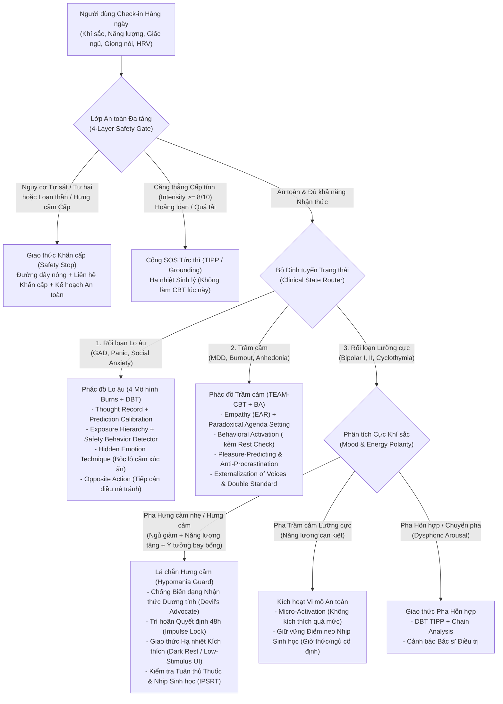
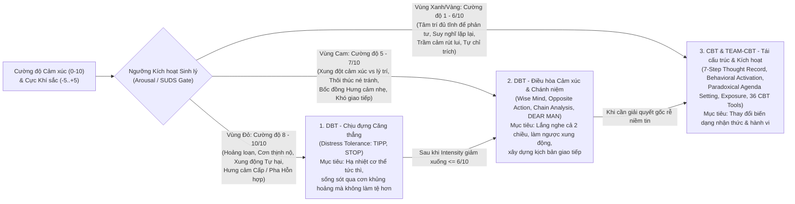
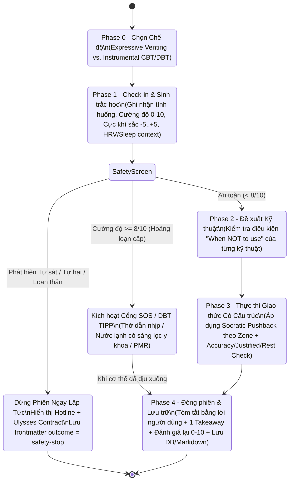
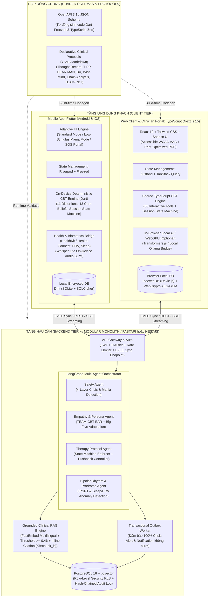

# ĐẶC TẢ KỸ THUẬT & LÂM SÀNG (TECHNICAL & CLINICAL SPECIFICATION)
## Hệ sinh thái Ứng dụng Đa nền tảng Hỗ trợ Rối loạn Lo âu, Trầm cảm và Rối loạn Lưỡng cực
**Kiến trúc:** Flutter (Android & iOS) + TypeScript / Next.js (Web Client & Clinician Portal) + Hybrid Local-First / Multi-Agent Backend

---

## 1. TỔNG HỢP PHÂN TÍCH 7 REPOSITORY NỀN TẢNG (RESEARCH SYNTHESIS)

Dự án được thiết kế dựa trên sự chắt lọc những tinh hoa lâm sàng và kiến trúc kỹ thuật từ 7 kho mã nguồn mở:

| Repository | Nền tảng / Công nghệ | Điểm mạnh cốt lõi & Giá trị kế thừa vào Spec | Bài học / Hạn chế cần khắc phục |
| :--- | :--- | :--- | :--- |
| **1. `glebis/claude-cognitive-toolkit`** | Claude Skill, Markdown State Machine, Python SVG generator, Telegram | - **Session State Machine (`session-engine.md`)**: Luồng 4 pha chặt chẽ (*Check-in → Safety/Technique Selection → Guided Protocol → Close & Save*).<br>- **Cơ chế Socratic Pushback 4 cấp độ** (`off`, `gentle`, `moderate`, `firm`) chia theo vùng (*Supportive*, *Core*, *Closing*).<br>- **Cơ chế Thoát An toàn Lâm sàng**: *Accuracy Check* (không ép tái cấu trúc nếu suy nghĩ là sự thật khách quan), *Justified Check* (Opposite Action), *Rest Check* (Behavioral Activation), *Medical Exclusion Screen* (trước khi dùng nước lạnh trong TIPP).<br>- **Health MCP (HRV & Sleep)**: So sánh với *baseline* cá nhân (25th-75th percentile trong 14–30 ngày), không dùng ngưỡng tuyệt đối hay so sánh trước/sau trong cùng 1 phiên. | Giao diện CLI/Telegram thuần văn bản, thiếu giao diện trực quan cho bệnh nhân lưỡng cực theo dõi biểu đồ khí sắc dài hạn. |
| **2. `irolinski/Well_CBT`** *(WorryFree)* | React Native, Expo, Redux, NativeWind, Calendars | - **Trải nghiệm Mobile On-the-go**: Thiết kế luồng Onboarding cá nhân hóa, phân tích biến dạng nhận thức (*Cognitive Distortion Analysis - CDA*), Nhật ký tâm trạng (*Mood Journal*).<br>- **Can thiệp Tức thì**: Bài tập thở tùy chỉnh nhịp độ, trò chơi/hoạt động đánh lạc hướng khi căng thẳng (*"Phone a Friend" distraction*).<br>- **Gắn kết người dùng**: Hệ thống Thành tựu (*Achievements*), Lịch sử hoạt động (*Activity Log Calendar*) có bộ lọc nâng cao. | Chưa có AI đồng hành theo thời gian thực và thiếu cơ chế cảnh báo sớm pha Hưng cảm/Trầm cảm cho Rối loạn lưỡng cực. |
| **3. `KazKozDev/cbt-assistant`** | Python FastAPI, Local Ollama (`qwen3.5:9b`), FastEmbed ONNX, SQLite | - **Kiến trúc Local-First & Grounded RAG**: Chia nhỏ tài liệu CBT theo phân cấp tiêu đề, nhúng bằng `paraphrase-multilingual-mpnet-base-v2`. Ngưỡng tương đồng nghiêm ngặt (`threshold = 0.46`) đảm bảo **100% Abstention Accuracy** (không tự bịa phác đồ lâm sàng khi không có trong KB, trích dẫn `[KB:chunk_id]`).<br>- **Bộ nhớ 2 tầng**: Lưu 20 tin nhắn gần nhất + *Rolling Summary* mỗi 15 tin nhắn + *Structured Personal Profile* trong SQLite.<br>- **Cổng SOS Toàn màn hình (SOS Portals)**: Thở dẫn nhịp, 5-4-3-2-1 Grounding, Thư giãn cơ tiến triển (PMR), kỹ thuật STOP kèm âm thanh môi trường offline.<br>- **Thang đo Lâm sàng**: PHQ-9, GAD-7, Rosenberg Self-Esteem, Burnout + xuất PDF. | Chưa có ứng dụng di động native (Flutter) và thiếu cơ chế đồng bộ đa thiết bị có mã hóa đầu cuối (E2EE). |
| **4. `Rayyan9477/Solace-AI`** | 10 FastAPI Microservices, LangGraph, Weaviate, PostgreSQL (RLS), Kafka | - **Điều phối Đa Tác tử (LangGraph Multi-Agent Orchestrator)**: Tách biệt rõ *Safety Agent* (4 lớp phát hiện khủng hoảng), *Emotion Agent* (phân tích cảm xúc qua văn bản & giọng nói Whisper/TTS), *Therapy Agent*, *Diagnosis Agent* (AMIE 4-step chain + Devil's Advocate), *Memory Agent* (5 tầng bộ nhớ + suy giảm Ebbinghaus), *Personality Agent* (OCEAN/Big Five).<br>- **Bảo mật Dữ liệu Y tế**: Thiết kế Row-Level Security (RLS), mã hóa PHI và chuỗi kiểm toán (Hash-chained Audit Log). | Qua tài liệu `SYSTEM-REVIEW-2026-07-21.md`, việc chia 10 microservices quá sớm gây lỗi kết nối (*OutboxPoller* không chạy, *InMemorySaver* làm mất trạng thái). **Giải pháp cho Spec này:** Dùng kiến trúc **Modular Monolith** (hoặc 3 dịch vụ cốt lõi) với Outbox Pattern chuẩn. |
| **5. `Andrew-FungKinHo/whynot`** *(Chihuahua)* | Flutter (Dart), Figma UI/UX | - **Giải tỏa Cảm xúc Đa phương thức (Audio/Video "Bursts")**: Cho phép người dùng xả stress qua ghi âm/video ngắn.<br>- **Phân loại Than phiền Lâm sàng**: Tách biệt *Expressive Complaints* (cần sự thấu cảm, lắng nghe, xác nhận cảm xúc) và *Instrumental Complaints* (cần giải pháp hành động, thay đổi thực tế).<br>- **Mood-Palette Generator**: Tạo bảng màu tâm trạng trực quan từ phân tích đa cảm xúc NLP theo thời gian thực. | Mô hình định giá quá cao, thiếu chiều sâu về bài tập CBT/DBT có cấu trúc. |
| **6. `alexcoledev/cbt-toolkit`** | Vanilla TypeScript/JS, HTML5, CSS3, REST API | - **36 Công cụ Chuyên biệt & Deterministic Pattern Matching**: Phát hiện nhanh 11 biến dạng nhận thức, 13 niềm tin cốt lõi (*Core Beliefs*) và hành vi an toàn (*Safety Behaviors*) với độ trễ **0ms**, hoàn toàn chạy trên trình duyệt (`localStorage`), bảo mật tuyệt đối.<br>- **Công cụ Độc quyền Giá trị cao**: *Prediction Calibration* (đối chiếu dự đoán thảm họa vs. thực tế), *Safety Behavior Detector*, *Exposure Hierarchy Builder* (thang tiếp xúc sợ hãi), *CBT-I Sleep Diary*. | Giao diện tĩnh đơn lẻ, chưa kết nối thành một hành trình điều trị xuyên suốt giữa Web và Mobile. |
| **7. `cognitivetech/David-Burns-Feeling-Good-TEAM-CBT`** | Kho tri thức lâm sàng TEAM-CBT của TS. David Burns | - **Khung trị liệu TEAM-CBT**: **T**esting (Brief Mood Survey trước & sau phiên) → **E**mpathy (5 Bí quyết Giao tiếp Hiệu quả **EAR**: *Disarming, Thought/Feeling Empathy, Inquiry, "I Feel" Statements, Affirmation*) → **A**genda Setting / Assessment of Resistance (*Paradoxical Agenda Setting*: *Magic Button, Positive Reframing, Magic Dial* — tìm ra điều đẹp đẽ và lợi ích của triệu chứng để làm tan sự kháng cự ngầm trước khi sửa suy nghĩ) → **M**ethods (Vòng tròn Phục hồi *Recovery Circle* >50 kỹ thuật: *Externalization of Voices, Double-Standard, Feared Fantasy, Downward Arrow, Pleasure-Predicting Sheet, Anti-Procrastination Sheet, Shame-Attacking*).<br>- **4 Mô hình Lo âu**: Cognitive, Exposure, Hidden Emotion ("bệnh tử tế" / kìm nén cảm xúc thật), Motivational.<br>- **Phân biệt Biến dạng Nhận thức Âm tính & Dương tính**: Rất quan trọng để áp dụng cho **pha Trầm cảm** (biến dạng âm tính) và **pha Hưng cảm/Hưng cảm nhẹ** (biến dạng dương tính) của Rối loạn Lưỡng cực. | Là kho tài liệu lý thuyết và podcast, cần được số hóa thành các State Machine tương tác trên Flutter và TypeScript. |

---

## 2. TỔNG QUAN SẢN PHẨM & ĐỊNH VỊ LÂM SÀNG (PRODUCT VISION & CLINICAL SCOPE)

### 2.1. Tên dự kiến & Tuyên ngôn Giá trị
**Equilibria (hoặc Mind Anchor)** — *Hệ sinh thái Hỗ trợ Tâm lý Đa nền tảng Dựa trên Bằng chứng Khoa học (TEAM-CBT, DBT & IPSRT).*

> [!IMPORTANT]
> **Tuyên bố Giới hạn Y khoa (Clinical Disclaimer):** Ứng dụng là công cụ thực hành tự lực (*self-help*), theo dõi triệu chứng và hỗ trợ giữa các buổi trị liệu (*between-session companion*). Ứng dụng **không phải là bác sĩ tâm thần**, không thay thế chẩn đoán y khoa và không tự ý kê đơn hay thay đổi liều thuốc (đặc biệt với thuốc ổn định khí sắc trong Rối loạn Lưỡng cực).

### 2.2. Ba Nhóm Đối tượng Mục tiêu & Cơ chế Thích ứng Lâm sàng



---

## 3. KIẾN TRÚC LÕI HAI LIỆU PHÁP: CBT (COGNITIVE BEHAVIORAL THERAPY) & DBT (DIALECTICAL BEHAVIOR THERAPY)

Trái tim của ứng dụng là sự kết hợp biện chứng giữa **CBT (Liệu pháp Nhận thức - Hành vi: Trọng tâm vào Thay đổi / Change)** và **DBT (Liệu pháp Hành vi Biện chứng: Trọng tâm vào Chấp nhận, Chịu đựng Căng thẳng & Điều hòa Cảm xúc / Acceptance & Regulation)**.

### 3.1. Nguyên lý Điều phối "DBT-First, CBT-Second" theo Ngưỡng Kích hoạt Sinh lý (SUDS / Arousal Threshold)
Một sai lầm phổ biến của các ứng dụng tâm lý thông thường là bắt người bệnh viết *Nhật ký Suy nghĩ (CBT Thought Record)* ngay khi họ đang hoảng loạn, kích động mạnh hoặc trong pha hỗn hợp lưỡng cực. Khi hệ thần kinh giao cảm đang bị kích hoạt cực độ (Intensity $\ge 7/10$), vỏ não trước trán (*Prefrontal Cortex*) bị tê liệt tạm thời, khiến mọi nỗ lực phân tích logic của CBT đều thất bại hoặc gây phản tác dụng.

Hệ thống áp dụng quy tắc định tuyến tự động giữa **DBT** và **CBT** dựa trên cường độ cảm xúc và cực khí sắc:



---

### 3.2. Đặc tả Toàn diện Phân hệ CBT & TEAM-CBT (Cognitive Behavioral Therapy Engine)

Dựa trên nền tảng của **Aaron Beck**, **Judith Beck**, **Greenberger & Padesky (*Mind Over Mood*)**, **Martell (*Behavioral Activation*)** và **David Burns (*Feeling Good / TEAM-CBT*)**:

#### A. Giao thức Cốt lõi 1: CBT 7-Step Thought Record (Nhật ký Suy nghĩ 7 Bước + Kiểm tra Độ chính xác)
Được số hóa từ `glebis/claude-cognitive-toolkit/references/thought-record.md`,`KazKozDev/cbt-assistant` và `alexcoledev/cbt-toolkit`:

| Bước | Tên bước | Vùng Pushback | Quy tắc Lâm sàng & Kiểm tra Hợp lệ (Move-to-next Criterion) |
| :--- | :--- | :--- | :--- |
| **Step 1** | **Situation** (Tình huống khách quan) | `Supportive` | Chỉ chấp nhận dữ kiện khách quan như "máy quay ghi lại được". Nếu người dùng gài suy diễn (*"Cô ấy cố tình phớt lờ tôi"*), AI tách bạch ngay: *"Đó là câu chuyện tâm trí kể — còn máy quay thực tế ghi nhận hành động gì?"* |
| **Step 2** | **Automatic Thought** (Suy nghĩ Tự động / Hot Cognition) | `Supportive` | Bắt trúng suy nghĩ thô đầu tiên thoáng qua đầu + đo mức độ tin tưởng ($0\text{--}100\%$). Nếu người dùng nêu cảm xúc thay vì suy nghĩ, AI hỏi ngược lại câu nói bên trong đầu tạo ra cảm xúc đó. **Phân loại ngầm (Silent Classification):** Đối chiếu với 11 Biến dạng Nhận thức Âm tính & 5 Biến dạng Dương tính (không thông báo lộ liễu để tránh làm người dùng phòng vệ). |
| **Step 3** | **Emotion & Pre-Intensity** (Gọi tên & Đo cường độ cảm xúc) | `Supportive` | Gọi tên chính xác cảm xúc (cung cấp bảng *Affect Labeling* 5 họ cảm xúc: *Anger, Sadness, Anxiety, Shame, Guilt* — phân biệt rõ *Shame = "Tôi tồi tệ"* vs. *Guilt = "Tôi làm sai một việc"*). Chấm điểm $0\text{--}10$ làm `pre_intensity`. |
| **Step 4** | **Evidence FOR** (Bằng chứng Ủng hộ suy nghĩ) | **`Core`** | Lắng nghe nghiêm túc suy nghĩ tự động. Phân biệt bằng chứng thực tế (*Hard Fact* trước tòa án) với suy diễn cảm tính. |
| **Step 5** | **Evidence AGAINST** (Bằng chứng Phản bác suy nghĩ) | **`Core` (Primary)** | Bước chuyển hóa quan trọng nhất. Áp dụng Socratic Pushback cao nhất thông qua các câu hỏi: *"Đã có lần nào trong đời suy nghĩ này sai chưa?"*, *"Bạn sẽ nói gì với người bạn thân nếu họ nghĩ như vậy?"* |
| **Cổng giữa 5 & 6** | **Accuracy Check** (Kiểm tra Tính Chính xác Thực tế) | **`None` (Tắt Pushback)** | **Điểm khác biệt sống còn:** Nếu suy nghĩ là sự thật khách quan (mất người thân, mất việc thật, nguy hiểm thật), **dừng ngay việc tái cấu trúc** (`outcome: accurate-thought-exit`) để tránh phủ nhận cảm xúc (*toxic positivity*). Chuyển sang: (1) *Problem-Solving* (bước nhỏ tiếp theo có thể làm), (2) *Coping* (chăm sóc bản thân vượt qua vài giờ tới), hoặc (3) *Split* (giữ lại sự kiện đúng: *"Tôi đã mắc 1 lỗi"*, chỉ tái cấu trúc kết luận phóng đại: *"Tôi là kẻ thất bại"*). |
| **Step 6** | **Balanced Thought** (Suy nghĩ Cân bằng / Thực tế) | **`Core`** | Không phải suy nghĩ tích cực giả tạo. Sử dụng khung biện chứng: *"Đúng là [Bằng chứng ủng hộ], VÀ đồng thời cũng đúng là [Bằng chứng phản bác]."* Đo lại độ tin tưởng ($0\text{--}100\%$). |
| **Step 7** | **Re-rate Emotion** (Đánh giá lại Cảm xúc) | `Closing` | Chấm lại cường độ $0\text{--}10$ (`post_intensity`), tính `intensity_delta`. Nếu cường độ tăng $\ge 3$ điểm do chạm vào nỗi đau sâu, tự động chuyển sang bài tập Grounding/TIPP để ổn định trước khi đóng phiên. |

#### B. Giao thức Cốt lõi 2: CBT Behavioral Activation 6 Bước (Kích hoạt Hành vi Chống Trầm cảm)
Được số hóa từ `glebis/claude-cognitive-toolkit/references/behavioral-activation.md` và *Pleasure-Predicting Sheet* của David Burns:
1. **Step 0 — Follow-up on Last Plan (Đối chiếu Sai số Dự đoán / Prediction-Error Correction):** Mở lại kế hoạch của phiên trước, hỏi mức độ Hài lòng (*Enjoyment* $0\text{--}10$) và Thành tựu (*Accomplishment* $0\text{--}10$) thực tế để chứng minh cho người bệnh thấy: *"Khi trầm cảm, não bộ luôn dự đoán niềm vui bằng 0, nhưng thực tế khi làm bạn đạt được 5/10."*
2. **Step 1 — What Has Dropped Away (Nhận diện Hoạt động Đã Đánh mất):** Rà soát 5 lĩnh vực bị thu hẹp khi trầm cảm (Kết nối con người, Vận động cơ thể, Sở thích cá nhân, Cảm giác hoàn thành, Chăm sóc không gian sống).
3. **Step 2 — Rest Check (Cổng Kiểm tra Nhu cầu Nghỉ ngơi Sinh học):** Tuyệt đối không dùng Pushback ở bước này. Nếu người dùng kiệt sức vì thiếu ngủ, bệnh lý thể chất, burnout hoặc mới trải qua mất mát → Chuyển kế hoạch thành **"Nghỉ ngơi Chủ động Không Áy náy" (Deliberate Guilt-free Rest)** có giờ bắt đầu và kết thúc, đóng phiên với `outcome: justified-exit`.
4. **Step 3 — What Matters (Lọc bỏ "Should Statements" để tìm Giá trị Thật):** Dùng Socratic Pushback để tách những việc *"Tôi nên/phải làm"* (áp lực từ bên ngoài) khỏi việc *"Có ý nghĩa với chính tôi"* (hoặc *"Ít tệ nhất trong tuần này"* nếu người bệnh đang vô cảm / *anhedonia*).
5. **Step 4 — One Activity, Made Small & Confidence Scaling (Thu nhỏ Hoạt động đến Ngưỡng Tự tin $\ge 7/10$):** Chọn 1 việc kéo dài 5–20 phút có Ngày, Giờ, Địa điểm cụ thể. Hỏi điểm tự tin $0\text{--}10$; nếu $< 7/10$, bắt buộc thu nhỏ hoạt động (ví dụ: từ *"Dọn cả căn phòng"* xuống *"Chỉ dọn mặt bàn làm việc trong 5 phút"*) cho đến khi đạt $\ge 7/10$.
6. **Step 5 & 6 — Predict & If-Then Barrier Plan:** Ghi lại dự đoán *Enjoyment / Accomplishment* ($0\text{--}10$) và lập phương án vượt rào cản theo cấu trúc: *"Nếu tới giờ đó tôi không có chút cảm hứng nào (rào cản chắc chắn sẽ xảy ra), thì tôi sẽ chỉ làm đúng 2 phút đầu tiên rồi được phép dừng."*

#### C. Giao thức Cốt lõi 3: Mở rộng TEAM-CBT của David Burns & 36 Công cụ Chuyên biệt (`cbt-toolkit`)
- **Paradoxical Agenda Setting (Làm tan Kháng cự trước khi thay đổi):** Gồm *Magic Button*, *Miracle Cure Question*, *Positive Reframing* (liệt kê 5–10 lợi ích và vẻ đẹp nhân văn của chính triệu chứng lo âu/trầm cảm/tội lỗi), *The Acid Test* và *Magic Dial* (chọn mức độ muốn giảm triệu chứng thay vì ép về 0%).
- **Uncovering Techniques (Khai quật 23 Niềm tin Tự hủy hoại - SDBs):** Kỹ thuật *Individual Downward Arrow*, *Interpersonal Downward Arrow* và *What-If Technique* để tìm ra gốc rễ (*Perfectionism, Approval Addiction, Love Addiction, Conflict Phobia, Spotlight Fallacy...*) rồi hóa giải bằng *Cost-Benefit Analysis*.
- **Role-Play CBT (Đóng vai Nội tâm):** *Externalization of Voices* (Tách giọng nói tự phán xét để phản biện bằng *Self-Defense* & *Acceptance Paradox*), *Paradoxical Double-Standard* (Tiêu chuẩn kép với bạn thân), *Feared Fantasy* (Đối diện kịch bản ác mộng nhất bằng sự hài hước/chấp nhận), và *Devil's Advocate* (Đóng vai "con quỷ cám dỗ" để người bệnh tự đấu tranh chống lại thói quen xấu hoặc cơn bốc đồng hưng cảm).
- **Hệ thống 36 Công cụ CBT Chuyên biệt (Deterministic Engine 0ms):** Bao gồm *Cognitive Distortion Checker*, *Prediction Calibration Tracker*, *Safety Behavior Detector*, *Exposure Hierarchy Builder*, *Anti-Procrastination Sheet*, *Pleasure-Predicting Sheet*, *CBT-I Sleep Diary & Sleep Efficiency Calculator*, *Panic Diary*, *ERP Tracker (cho OCD)*, *Core Belief Tracker & Positive Data Log*.

---

### 3.3. Đặc tả Toàn diện Phân hệ DBT (Dialectical Behavior Therapy Engine)

Dựa trên cẩm nang **DBT Skills Training Manual (2nd Ed.) của GS. Marsha Linehan** và được số hóa chi tiết theo 5 giao thức DBT trong `glebis/claude-cognitive-toolkit`:

DBT là trụ cột **không thể thiếu** đối với:
- **Rối loạn Lưỡng cực:** Kiểm soát cơn bão cảm xúc ở pha Hỗn hợp (*Mixed State*), kiềm chế xung động tiêu tiền/nghỉ việc/tình dục nguy hiểm ở pha Hưng cảm nhẹ, và phân tích chuỗi hành vi mất kiểm soát sau khi qua cơn.
- **Rối loạn Lo âu & Hoảng loạn cấp:** Hạ nhiệt sinh lý tức thì khi không thể suy nghĩ logic.
- **Trầm cảm nặng kèm Xung động Tự hại hoặc Mâu thuẫn Quan hệ:** Chịu đựng đau khổ mà không làm tình hình tồi tệ hơn và giao tiếp giữ vững lòng tự trọng.

Ứng dụng tích hợp đầy đủ **4 Nhóm Kỹ năng (4 Modules) của DBT** thông qua 5 Giao thức Tương tác Có Cấu trúc:

#### 1. Module Chịu đựng Căng thẳng (DBT Distress Tolerance) — Kỹ thuật `TIPP` & `STOP`
- **Khi nào kích hoạt:** Cường độ cảm xúc ở mức báo động ($8\text{--}10/10$), hoảng loạn, ngập lụt cảm xúc (*emotional flooding*), suy nghĩ chạy quá nhanh không thể làm Thought Record.
- **Quy tắc Pushback:** **Tắt hoàn toàn Pushback (`off`) ở mọi cấp độ.** Câu lệnh cực ngắn, từng bước một, không hỏi "tại sao", không phân tích đúng sai.
- **4 Kỹ năng Sinh lý (`TIPP`)** (Người dùng chỉ cần chọn 1, mặc định là *Paced Breathing*):
  1. **T — Temperature (Thay đổi Nhiệt độ cơ thể kích hoạt Phản xạ Lặn / Mammalian Dive Reflex):**
     - **Cổng Sàng lọc Y khoa Bắt buộc (Mandatory Medical Exclusion Screen):** Trước khi hướng dẫn, ứng dụng bắt buộc hỏi: *"Trước khi dùng nước lạnh: Bạn có mắc bệnh tim mạch, nhịp tim chậm, đang dùng thuốc chẹn beta (beta-blockers), dị ứng lạnh, rối loạn ăn uống, hoặc đang mang thai có lưu ý y khoa không?"* → Nếu chọn **Có** hoặc **Không chắc**, hệ thống khóa ngay bước Nước lạnh và chuyển sang *Thở dẫn nhịp*.
     - Nếu **Không**: Hướng dẫn cúi người, nín thở và áp nước lạnh/túi chườm lạnh lên vùng mắt và gò má đúng **15–30 giây** (có đồng hồ đếm ngược trên màn hình, tuyệt đối không gợi ý ngâm mình trong bồn nước đá).
  2. **I — Intense Exercise (Vận động Cường độ Cao Ngắn hạn):** 5–10 phút vận động mạnh tại chỗ (leo cầu thang, jumping jacks, đi bộ nhanh) để đốt cháy lượng adrenaline/cortisol dư thừa (bỏ qua nếu đang chấn thương/kiệt sức).
  3. **P — Paced Breathing (Thở Dẫn nhịp Giảm Kích thích Giao cảm):** Hít vào bằng mũi 4 giây, thở ra chậm 6–8 giây (nhịp thở ra bắt buộc dài hơn nhịp hít vào để kích hoạt hệ thần kinh đối giao cảm / dây thần kinh phế vị). Nếu người dùng thấy chóng mặt, cho dừng ngay để thở bình thường.
  4. **P — Paired Muscle Relaxation (Thư giãn Cơ Kết hợp Nhịp thở):** Hít vào gồng căng từng nhóm cơ 5 giây (từ bàn chân → bắp chân → đùi → bụng → tay → vai → mặt), thở ra buông lỏng hoàn toàn.
- **Đánh giá lại & Ngắt Vòng lặp An toàn:** Sau khi làm xong 1 kỹ năng, chấm lại cường độ ($0\text{--}10$). Nếu vẫn $\ge 7$, chỉ gợi ý thử thêm tối đa 1 kỹ năng khác. Nếu sau 2 kỹ năng vẫn không giảm, **dừng chu trình**, chuyển sang chế độ đồng hành tĩnh lặng và hiển thị danh bạ hỗ trợ khẩn cấp (`outcome: stopped-early`).

#### 2. Module Điều hòa Cảm xúc (DBT Emotion Regulation) — Kỹ thuật `Opposite Action` (Hành động Đối nghịch)
- **Nguyên lý Lâm sàng (Linehan, 1993):** Mỗi cảm xúc đều được duy trì bởi một **Thôi thúc Hành động (Action Urge)** (VD: Sợ hãi → Thôi thúc trốn chạy; Trầm cảm/Buồn bã → Thôi thúc rút lui lên giường; Giận dữ → Thôi thúc công kích; Xấu hổ → Thôi thúc che giấu). Khi thôi thúc đó không phù hợp với sự thật khách quan, làm ngược lại 100% (*All the way*) sẽ tái lập trình lại chính cảm xúc đó.
- **4 Bước Thực thi Có Cấu trúc (`references/opposite-action.md`):**
  1. **Step 1 — Name the Emotion (`Supportive`):** Gọi tên chính xác cảm xúc chủ đạo đang điều khiển cơ thể.
  2. **Step 2 — Identify the Action Urge (`Core`):** Xác định rõ cảm xúc đang xúi giục làm hành động gì (tấn công, gửi tin nhắn cay nghiệt, hủy hẹn, nằm lì trên giường, xin lỗi quá mức...).
  3. **Step 3 — Justified Check (`Core` — Điểm Xoay Biện chứng / Dialectical Pivot):**
     - Hỏi: *"Cảm xúc của bạn hoàn toàn hợp lệ, nhưng **thôi thúc hành động** này có phù hợp với sự thật khách quan của tình huống không?"*
     - **Quy tắc An toàn Tuyệt đối:** Nếu tình huống có nguy hiểm thực tế (bạo lực, đe dọa, người không an toàn), nỗi sợ là hoàn toàn chính đáng → **Tắt Pushback**, xác nhận việc rút lui/tránh xa là đúng đắn và đóng phiên với `outcome: justified-exit`.
     - Nếu thôi thúc là chính đáng trong tình huống bình thường → Chuyển sang hướng dẫn hành động khéo léo (*Skillful Action*).
     - Nếu thôi thúc **không chính đáng** hoặc cường độ quá mức (và đặc biệt hữu ích khi bệnh nhân Lưỡng cực có thôi thúc bốc đồng trong pha Hưng cảm nhẹ) → Chuyển sang Step 4.
  4. **Step 4 — Act Opposite All The Way (`Core`):** Xác định hành động ngược chiều khả thi ngay trong 10–60 phút tới (VD: Đang muốn rút lui → Nhắn tin cho 1 người hoặc bước ra ngoài đi bộ 5 phút; Đang muốn gửi tin nhắn mắng mỏ → Cất điện thoại, nói nhẹ nhàng; Đang hưng cảm muốn thức trắng đêm làm dự án → Tắt đèn, nằm nghỉ ngơi tĩnh lặng). Nhấn mạnh nguyên tắc: **Làm ngược lại toàn diện (cả tư thế cơ thể, nét mặt và hành động)**.

#### 3. Module Chánh niệm Cốt lõi (DBT Core Mindfulness) — Kỹ thuật `Wise Mind` (Tâm Trí Tuệ)
- **Nguyên lý Lâm sàng (`references/wise-mind.md`):** Khi người bệnh bị giằng xé giữa hai thái cực — **Emotion Mind (Tâm Cảm xúc: nóng vội, bốc đồng, tuyệt vọng)** và **Reasonable Mind (Tâm Lý trí: lạnh lùng, cứng nhắc, hoặc tự phán xét trá hình lý trí)** — kỹ thuật này giúp họ tìm thấy giao điểm **Wise Mind (Tâm Trí Tuệ)**.
- **6 Bước Thực thi & Quy tắc Trung lập Tuyệt đối:**
  1. **Step 1 — Name the Question (`Supportive`):** Đặt câu hỏi cho quyết định đang giằng xé trong 1 câu ngắn. (Nếu quyết định liên quan đến thuốc men/điều trị y khoa, ứng dụng nhắc rõ đây là công cụ làm rõ mong muốn cá nhân, không phải lời khuyên y tế).
  2. **Step 2 — Emotion Mind (`Core`):** Để phần cảm xúc lên tiếng trọn vẹn mà không chỉnh sửa. Dùng Pushback nếu người dùng lấy lý lẽ đè nén cảm xúc.
  3. **Step 3 — Reasonable Mind (`Core`):** Chỉ liệt kê dữ kiện, logic và hệ quả thực tế cho cả 2 phương án. **Phát hiện Tự chỉ trích Trá hình (Harsh Self-Critic Guard):** Nếu người dùng viết *"Lý trí bảo tôi quá yếu đuối nên mới không làm được"*, AI nhẹ nhàng chỉ ra: *"Đó là giọng nói của kẻ phán xét chứ không phải lý trí. Nếu bỏ lời phán xét bản thân ra, dữ kiện thực tế còn lại là gì?"*
  4. **Step 4 — Pause (`Supportive` — Pushback Off):** Dừng lại hít thở chậm (vào 4s, ra 6–8s), đặt câu hỏi vào hơi thở vào và lắng nghe trong hơi thở ra.
  5. **Step 5 — Wise Mind (`Supportive` — Không bao giờ ép phải có câu trả lời):** Hỏi *"Khi cả hai phía đều được lắng nghe nghiêm túc, bạn nhận ra điều gì?"* Chấp nhận 3 kết quả hợp lệ ngang nhau: (a) Một quyết định rõ ràng, (b) Một bước thử nghiệm nhỏ hơn, hoặc (c) **"Chưa biết / Nothing yet"** (hẹn thời điểm sẽ hỏi lại). **AI tuyệt đối không bao giờ chọn giúp người dùng phương án nào là đúng** (trừ khi 1 phương án dẫn tới nguy hiểm tính mạng).
  6. **Step 6 — One Next Step (`Supportive`):** Chốt 1 bước hành động nhỏ tiếp theo hoặc thời điểm xem xét lại.

#### 4. Module Phân tích Hành vi & Phòng ngừa Tái phát (DBT Behavioral Analysis) — Kỹ thuật `Chain Analysis` (Phân tích Chuỗi Hành vi)
- **Nguyên lý Lâm sàng (`references/chain-analysis.md`):** Giải phẫu một hành vi cụ thể mà người bệnh vừa làm và cảm thấy hối tiếc (bùng nổ cơn giận, chi tiêu bốc đồng trong cơn hưng cảm nhẹ, uống rượu, thức khuya lướt mạng 4 tiếng, hoặc trì hoãn bỏ lỡ một việc quan trọng — *Missing-Links Analysis*) theo tinh thần **Tò mò, Không phán xét (Curiosity, Not Blame)**.
- **Cổng Chặn Cứng Lâm sàng (Hard Stops) & Bảo vệ Cảm giác Xấu hổ (Shame Protocol):**
  - **Hard Stop 1:** Tuyệt đối **KHÔNG** chạy *Chain Analysis* trên hành vi tự hại (*self-harm*) hoặc toan tự sát — việc phân tích chuỗi tự hại bắt buộc phải thực hiện trực tiếp với nhà trị liệu DBT có chuyên môn.
  - **Hard Stop 2:** Tuyệt đối **KHÔNG** chạy *Chain Analysis* trên việc người dùng là nạn nhân bị người khác xâm hại/lừa dối/bạo hành (đó không phải lỗi hay chuỗi hành vi của họ).
  - **Shame Protocol:** Ngay khi người dùng xuất hiện cảm giác xấu hổ gay gắt (*"Tôi thật ngu ngốc, không hiểu sao tôi lại làm thế"*), AI lập tức tắt toàn bộ Pushback, gọi tên sự xấu hổ một cách ấm áp, giảm nhịp độ và cho phép nghỉ giải lao.
- **6 Bước Giải phẫu Mắt xích:**
  1. **Target Behaviour (`Core`):** Mô tả chính xác 1 lần cụ thể (Làm gì, ở đâu, lúc nào, kéo dài bao lâu).
  2. **Prompting Event (`Core`):** Khoảnh khắc ngay trước khi mọi thứ trượt đi (giọt nước tràn ly).
  3. **Vulnerabilities (`Supportive`):** Các yếu tố làm suy yếu sức đề kháng tâm lý trong ngày hôm đó (*DBT PLEASE factors*: thiếu ngủ, bỏ bữa/quá nhiều caffeine, đau ốm thể chất, chất kích thích, căng thẳng tích tụ, xung đột trước đó).
  4. **The Links (`Core`):** Liệt kê 5–10 mắt xích nối từ sự kiện kích hoạt đến hành vi, gán nhãn rõ từng mắt xích: `[thought]`, `[feeling]`, `[body sensation]`, `[action]`, hoặc `[external]` (kèm biến thể *Missing-Links* nếu là việc đã không làm).
  5. **Consequences (`Supportive`):** Nhìn nhận trung thực **Lợi ích Ngắn hạn** (sự khuây khỏa, trốn thoát cảm xúc trong khoảnh khắc đó — lý do khiến hành vi lặp lại) và **Cái giá Dài hạn** đối với bản thân và người khác.
  6. **Break Points, Prevention & Repair (`Core`):** Chọn 1–3 mắt xích trên chuỗi và thiết kế **Kỹ năng Thay thế Cụ thể** cho lần sau; 1 bước **Phòng ngừa** từ yếu tố dễ tổn thương (Step 3); và 1 bước **Sửa chữa (Repair)** lành mạnh với người bị ảnh hưởng (không khuyến khích xin lỗi rập khuôn quá mức).

#### 5. Module Hiệu quả Liên cá nhân (DBT Interpersonal Effectiveness) — Kỹ thuật `DEAR MAN` + AI Roleplay
- **Nguyên lý Lâm sàng (`references/dear-man.md`):** Giúp người bệnh soạn thảo kịch bản ngắn gọn (4–6 câu bằng chính giọng văn của họ) để **Đưa ra yêu cầu** hoặc **Từ chối (Say No)**, đặc biệt kết nối chặt chẽ với *Hidden Emotion Model* của CBT (giải phóng cảm xúc bị đè nén vì sợ mất lòng).
- **Cổng An toàn Quan hệ:** Nếu người đối diện là đối tượng nguy hiểm/bạo hành, tuyệt đối không hướng dẫn thương lượng hay đóng vai đối đầu mà chuyển ngay sang giao thức an toàn.
- **7 Bước Xây dựng Kịch bản + Tập dượt Đóng vai (Roleplay Rehearsal):**
  1. **Step 1 — The Ask & Priority (`Core`):** Xác định rõ muốn yêu cầu hay từ chối điều gì trong 1 câu, và ưu tiên lớn nhất là gì (*Đạt mục tiêu / Giữ mối quan hệ / Giữ lòng tự trọng*).
  2. **Step 2 — D = Describe (`Core`):** Chỉ nêu sự thật khách quan như máy quay ghi lại. Dùng Pushback để lọc bỏ các từ quy chụp (*"luôn luôn", "không bao giờ"*, đọc suy nghĩ).
  3. **Step 3 — E = Express (`Supportive`):** Diễn đạt cảm xúc theo cấu trúc *"Tôi cảm thấy..."*, không dùng câu đổ lỗi *"Bạn làm tôi thấy..."*.
  4. **Step 4 — A = Assert (`Core`):** Nói thẳng yêu cầu hoặc lời từ chối. Dùng Pushback để giúp người dùng bỏ thói quen rào đón xin lỗi ở đầu câu (*"Xin lỗi làm phiền, không biết có được không..."*).
  5. **Step 5 — R = Reinforce (`Supportive`):** Nêu lợi ích thực tế cho người kia hoặc cho mối quan hệ nếu họ đồng ý (không đe dọa).
  6. **Step 6 — Delivery Plan: M-A-N (`Supportive`):**
     - **M — Mindful (Tập trung / Kỹ thuật Đĩa nhạc bị xước - Broken Record):** Chọn 1 câu ngắn để lặp lại bình tĩnh khi đối phương đánh trống lảng hoặc công kích.
     - **A — Appear Confident (Phong thái Tự tin):** Giọng nói, tư thế, không nhỏ giọng ở cuối câu.
     - **N — Negotiate (Thương lượng & Giới hạn):** Mức tối thiểu có thể chấp nhận là gì, điều gì là không thể nhân nhượng, hoặc kỹ thuật *"Đẩy bóng lại" (Turn the tables: "Vậy theo bạn chúng ta nên giải quyết thế nào?")*.
  7. **Step 7 — Read Back & Optional AI Roleplay (`Closing`):** Ghép thành kịch bản hoàn chỉnh và mời người dùng **Tập dượt Đóng vai (1–3 vòng ngắn)**: AI đóng vai người đối diện với mức độ kháng cự vừa phải (điều chỉnh được bằng lệnh `harder` / `softer`), sau mỗi vòng AI bước ra khỏi vai diễn để đưa ra **1 điểm người dùng đã làm tốt** và **1 gợi ý tinh chỉnh cho vòng tiếp theo** (và kết hợp được với *5 Bí quyết Giao tiếp EAR* của David Burns khi đối phương chỉ trích).

---

### 3.4. Bảng Xếp hạng & Chuyên sâu Các Kỹ thuật CBT và DBT Hiệu quả Nhất (Gold-Standard Evidence-Based Selection)

Dựa trên hướng dẫn thực hành lâm sàng quốc tế (**NICE Guidelines**, **APA Practice Guidelines**, **CANMAT/ISBD cho Rối loạn Lưỡng cực**), dưới đây là các kỹ thuật CBT & DBT có **mức độ bằng chứng lâm sàng cao nhất (Tier-1 / Gold Standard)** được tích hợp chuyên biệt vào hệ thống cho từng bệnh lý:

#### A. Nhóm 1: Rối loạn Lo âu (GAD, Panic Disorder, Social Anxiety, OCD)
| Liệu pháp | Kỹ thuật Tốt nhất (Gold Standard) | Cơ chế Lâm sàng & Thiết kế Tính năng trong App |
| :--- | :--- | :--- |
| **CBT** | **1. Tiếp xúc & Ngăn ngừa Phản ứng (Exposure Therapy / ERP & Interoceptive Exposure)** | *Tiêu chuẩn vàng số 1 cho mọi loại lo âu.*<br>- **Exposure Hierarchy Builder:** Xây dựng thang sợ hãi (SUDS $0\text{--}100$) kèm theo dõi quá trình quen dần (*Habituation / Inhibitory Learning*).<br>- **Interoceptive Exposure (cho Rối loạn Hoảng loạn):** Các bài tập an toàn mô phỏng triệu chứng cơ thể (thở nhanh nhẹ, xoay vòng nhẹ — có sàng lọc y khoa) giúp người bệnh nhận ra tim đập nhanh không gây đau tim hay ngất xỉu.<br>- **Safety Behavior Detector:** Phát hiện và gỡ bỏ dần các hành vi an toàn ngầm (luôn mang thuốc bên mình, kiểm tra mạch liên tục, né tránh ánh mắt). |
| **CBT** | **2. Trì hoãn Lo lắng & Thời gian Lo lắng (Worry Postponement / Scheduled Worry Time)** | *Hiệu quả nhất cho Rối loạn Lo âu Lan tỏa (GAD).*<br>- Khi cơn lo âu kéo đến giữa ngày, người dùng bấm 1 chạm **"Gửi vào Hộp Lo âu (Worry Box)"** và hẹn xử lý vào khung giờ cố định (VD: 17:30–17:45 mỗi ngày).<br>- Tách riêng 2 nhóm: *Lo lắng có thể giải quyết (Productive Worry)* → chuyển sang *Problem-Solving*, và *Lo lắng giả định (Hypothetical "What-If" Worry)* → chuyển sang *Worry Script / Acceptance*. |
| **CBT** | **3. Giải thảm họa & Hiệu chỉnh Dự đoán (Decatastrophizing & Prediction Calibration)** | - **What-If / Downward Arrow:** Đi tới tận cùng kịch bản xấu nhất (*"Giả sử điều đó xảy ra thật thì sao? Tôi sẽ đối phó thế nào sau 1 tuần, 1 tháng?"*).<br>- **Prediction Calibration Log:** Lưu xác suất thảm họa dự đoán vs. kết quả thực tế để hiệu chỉnh sai số nhận thức. |
| **DBT** | **4. Hạ nhiệt Sinh lý Cấp (`TIPP`) & Neo Thực tại (`5-4-3-2-1` / `STOP`)** | *Cắt cơn hoảng loạn cấp trong 2–5 phút* trước khi làm bất kỳ bài tập nhận thức nào (Thở 4-6 có Haptics, Nước lạnh có sàng lọc tim mạch, PMR). |
| **DBT** | **5. Kiểm tra Sự thật (`Check the Facts`) & Hành động Đối nghịch (`Opposite Action` cho Sợ hãi)** | - Tách cảm xúc lo âu khỏi mối đe dọa thực tế. Khi xác nhận mối đe dọa không có thật → Hành động ngược lại cơn sợ: **Tiếp cận thay vì né tránh**, thả lỏng vai và mở lòng bàn tay (*Willing Hands*). |
| **DBT** | **6. Chấp nhận Hoàn toàn (`Radical Acceptance`) & Quan sát Không Phán xét (`Urge Surfing`)** | - Cho phép cảm giác lo âu tồn tại như một cơn sóng (*lên đỉnh rồi tự hạ*) mà không chống cự hay tìm cách kiểm soát (chống lại vòng xoáy *"Lo lắng về chính việc mình đang lo lắng"*). |

#### B. Nhóm 2: Rối loạn Trầm cảm (Major Depressive Disorder, Dysthymia, Burnout)
| Liệu pháp | Kỹ thuật Tốt nhất (Gold Standard) | Cơ chế Lâm sàng & Thiết kế Tính năng trong App |
| :--- | :--- | :--- |
| **CBT** | **1. Kích hoạt Hành vi (Behavioral Activation - BA) kèm `Rest Check` & `Pleasure-Predicting`** | *Bằng chứng lâm sàng mạnh nhất cho Trầm cảm vừa và nặng (hiệu quả tương đương hoặc vượt trội tái cấu trúc nhận thức đơn thuần).*<br>- Phá vỡ vòng xoáy *"Mất năng lượng → Rút lui → Mất nguồn khen thưởng tích cực → Trầm cảm nặng hơn"*.<br>- **Graded Task Assignment & Mastery/Pleasure (M/P) Rating:** Chia nhỏ việc thành bước 2–5 phút đạt tự tin $\ge 7/10$, ghi nhận 2 chỉ số riêng: **M (Mastery - Cảm giác hoàn thành)** và **P (Pleasure - Niềm vui)**.<br>- Có **Cổng `Rest Check`** tránh ép hoạt động khi đang kiệt sức sinh học. |
| **CBT** | **2. Tái cấu trúc Suy nghĩ & Giải mã Niềm tin Cốt lõi (7-Step Thought Record + Downward Arrow + TEAM-CBT)** | - Bẻ gãy **Tam giác Nhận thức Trầm cảm của Beck** (*Tiêu cực về Bản thân — Thế giới — Tương lai*).<br>- Kết hợp **Paradoxical Agenda Setting** (làm tan kháng cự), **Externalization of Voices**, **Double-Standard** và **Accuracy Check** (tôn trọng nỗi đau có thật). |
| **CBT** | **3. Huấn luyện Giải quyết Vấn đề Có Cấu trúc (Problem-Solving Therapy - PST) & CBT-I (Trị liệu Mất ngủ)** | - Người trầm cảm thường bị "sương mù não" (*cognitive fog*) và mất ngủ kinh niên. App cung cấp trình hướng dẫn giải quyết 1 vấn đề cụ thể theo 5 bước nhỏ và **Nhật ký Giấc ngủ CBT-I** (tính hiệu suất ngủ *Sleep Efficiency* và kiểm soát kích thích giường ngủ). |
| **DBT** | **4. Chăm sóc Sinh học Nền tảng (`ABC PLEASE` Skill)** | *Xây dựng lá chắn chống dễ tổn thương cảm xúc:*<br>- **A (Accumulate Positives):** Tích lũy trải nghiệm tích cực ngắn hạn & dài hạn theo giá trị.<br>- **B (Build Mastery):** Làm 1 việc nhỏ tạo cảm giác tự chủ mỗi ngày.<br>- **C (Cope Ahead):** Diễn tập trước trong tâm trí cách đối phó với tình huống khó sắp tới.<br>- **PLEASE:** Điều trị bệnh thể chất (*PhysicaL illness*), Ăn uống cân bằng (*Eating*), Tránh chất kích thích (*Avoid mood-altering substances*), Ngủ đủ (*Sleep*), Vận động (*Exercise*). |
| **DBT** | **5. Hành động Đối nghịch (`Opposite Action` cho Nỗi buồn & Sự Xấu hổ)** | - Khi trầm cảm xúi giục nằm lì, đóng cửa, không trả lời tin nhắn → Hành động ngược lại toàn diện: mở rèm đón ánh sáng, đứng dậy đi lại, nhắn 1 câu ngắn cho người an toàn. |
| **DBT** | **6. Chịu đựng Đau khổ (`ACCEPTS` & `Self-Soothe` 5 Giác quan)** | - Khi cảm giác trống rỗng hoặc đau khổ quá nặng nề trong ngày, dùng bộ công cụ đánh lạc hướng lành mạnh (**ACCEPTS**: *Activities, Contributing, Comparisons, Emotions, Pushing away, Thoughts, Sensations*) và tự xoa dịu qua 5 giác quan (*Self-Soothe*) để vượt qua khoảng thời gian tăm tối an toàn. |

#### C. Nhóm 3: Rối loạn Lưỡng cực (Bipolar I, Bipolar II, Cyclothymia)
*(Lưu ý lâm sàng: Trong Rối loạn Lưỡng cực, **CBT & DBT là liệu pháp bổ trợ chuẩn vàng song hành cùng thuốc ổn định khí sắc** và **IPSRT**, tuyệt đối không thay thế thuốc).*

| Liệu pháp | Kỹ thuật Tốt nhất (Gold Standard) | Cơ chế Lâm sàng & Thiết kế Tính năng trong App |
| :--- | :--- | :--- |
| **CBT** *(Bipolar-Adapted)* | **1. Lập Bản đồ Dấu hiệu Tiền triệu & Phòng ngừa Tái phát (Relapse Prevention / Prodrome Signature Mapping)** | *Kỹ thuật CBT hiệu quả nhất để giảm tỷ lệ nhập viện ở bệnh nhân Lưỡng cực (Lam et al., NICE).*<br>- Xác định danh sách 3–5 dấu hiệu cảnh báo sớm độc nhất của riêng bệnh nhân cho cả **Cực Hưng cảm** và **Cực Trầm cảm**, gắn trực tiếp vào **Ulysses Contract** và kích hoạt kế hoạch hành động 3 bước ngay khi phát hiện. |
| **CBT** *(Bipolar-Adapted)* | **2. Kiểm chứng Thực tế & Phản biện Biến dạng Dương tính (Reality Testing / Positive Distortion Checker + 48h Rule)** | *Chuyên biệt cho pha Hưng cảm nhẹ (+1 đến +3):*<br>- Dùng **Quy tắc Trì hoãn 48 Giờ (48-Hour Impulse Vault)** + **Quy tắc "Tham khảo 2 Người Tin cậy" (Two-Person Reality Check)** trước mọi quyết định tài chính, tình cảm, nghề nghiệp lớn.<br>- Dùng kỹ thuật **Devil's Advocate** của David Burns để kiểm tra các suy nghĩ tự cao/lạc quan thái quá (*"Tôi không cần ngủ nữa"*, *"Dự án này chắc chắn thành công 100%"*) mà không gây tranh cãi đối đầu. |
| **CBT** *(Bipolar-Adapted)* | **3. Quản lý Tuân thủ Thuốc & Tái cấu trúc Niềm tin về Thuốc (Medication Adherence CBT)** | - Tỷ lệ tự ý bỏ thuốc ở bệnh nhân Lưỡng cực rất cao (đặc biệt khi thấy khỏe lại hoặc nhớ cảm giác hưng phấn). App dùng *Cost-Benefit Analysis* và *Thought Record* chuyên biệt cho suy nghĩ *"Mình đã khỏi rồi, không cần uống thuốc nữa"* hoặc *"Uống thuốc làm mình mất sự sáng tạo"*. |
| **CBT** *(Bipolar-Adapted)* | **4. Kiểm soát Mức độ Kích hoạt & Bảo vệ Giấc ngủ (Activity Pacing & CBT-I Modified for Bipolar)** | - **Khác biệt sống còn với Trầm cảm đơn cực:** Trong pha trầm cảm lưỡng cực, **không kích hoạt quá đà** (tránh gây chuyển pha hưng cảm / *Manic Switch*); trong pha hưng cảm nhẹ, áp dụng **Activity Restriction & Dark Therapy** (giảm số đầu việc, giảm ánh sáng xanh buổi tối, giữ chặt 5 mốc nhịp sinh học **IPSRT**). |
| **DBT** | **5. Kỹ năng `STOP`, `Pros & Cons` (Khủng hoảng) & `Wise Mind`** | *Lá chắn chống bốc đồng cốt lõi trong pha Hưng cảm nhẹ & Pha Hỗn hợp:*<br>- **STOP** (*Stop — Take a step back — Observe — Proceed mindfully*) chặn đứng xung động mua sắm, cãi vã, gửi tin nhắn phá hủy mối quan hệ.<br>- **Crisis Pros & Cons:** Bảng 4 ô nhanh so sánh *Lợi/Hại của việc hành động theo xung động ngay bây giờ* vs. *Lợi/Hại của việc chịu đựng xung động và chờ 48 giờ*. |
| **DBT** | **6. `TIPP` (cho Pha Hỗn hợp / Mixed State) & `PLEASE` (Ổn định Sinh học)** | - **Pha Hỗn hợp (Khí sắc trầm cảm + Năng lượng kích động cao)** là trạng thái nguy hiểm nhất: Bắt buộc dùng **DBT `TIPP`** để hạ kích động thần kinh ngay lập tức.<br>- **DBT `PLEASE`** đặc biệt nhấn mạnh yếu tố **S (Sleep — Giấc ngủ cố định giờ)** và **A (Avoid — Tuyệt đối tránh rượu, caffeine liều cao, chất kích thích)** vì đây là 2 ngòi nổ chuyển pha mạnh nhất của Lưỡng cực. |
| **DBT** | **7. Giải phẫu Chuỗi Hành vi (`Chain Analysis`) & Hàn gắn Quan hệ (`DEAR MAN` / `GIVE` / `FAST`)** | - Sau mỗi cơn hưng cảm nhẹ hoặc bùng nổ cáu gắt, dùng **Chain Analysis** để nhìn thấy rõ mắt xích nào (bỏ thuốc, thức khuya 2 đêm, xung đột công việc) đã châm ngòi cho cơn bệnh — từ đó thiết kế điểm ngắt cho lần sau.<br>- Dùng bộ kỹ năng giao tiếp DBT (**DEAR MAN** cho mục tiêu, **GIVE** cho giữ gìn sự ấm áp trong gia đình, **FAST** cho giữ lòng tự trọng không tự sỉ nhục sau cơn bệnh) để hàn gắn mối quan hệ với người thân. |

---

### 3.5. Ma trận Phối hợp CBT × DBT Chuyên biệt cho 3 Nhóm Bệnh lý

| Bệnh lý & Trạng thái Lâm sàng | Vai trò của DBT (Ổn định, Chấp nhận & Điều hòa) | Vai trò của CBT & TEAM-CBT (Tái cấu trúc & Thay đổi) |
| :--- | :--- | :--- |
| **1. Rối loạn Lo âu**<br>*(GAD, Panic, Social Anxiety, OCD)* | - **Cơn Hoảng loạn Cấp (Intensity $\ge 8$):** **DBT `TIPP`** + **`STOP`** + **`5-4-3-2-1`** để cắt cơn kích hoạt giao cảm.<br>- **Né tránh & Sợ hãi:** **`Check the Facts`** + **`Opposite Action`** + **`Willing Hands`**.<br>- **Lo âu mãn tính:** **`Radical Acceptance`** + **`Urge Surfing`**.<br>- **Sợ Mất lòng / Ranh giới:** **`DEAR MAN`** kèm AI Roleplay. | - **Tiêu chuẩn vàng:** **Exposure Hierarchy / ERP**, **Interoceptive Exposure**, **Safety Behavior Detector**.<br>- **GAD:** **Worry Postponement (Hộp Lo âu)** + **Problem-Solving**.<br>- **Nhận thức & Động lực:** **Paradoxical Agenda Setting**, **7-Step Thought Record + Prediction Calibration**, **Hidden Emotion Technique**. |
| **2. Rối loạn Trầm cảm**<br>*(MDD, Burnout, Low Self-Esteem)* | - **Nền tảng Sinh học:** **`ABC PLEASE`** (tích lũy trải nghiệm tích cực, làm chủ, ngủ/ăn/vận động).<br>- **Nằm lì / Cô lập:** **`Opposite Action`** cho nỗi buồn & xấu hổ.<br>- **Đau khổ / Trống rỗng cấp:** **`ACCEPTS`** & **`Self-Soothe`** 5 giác quan.<br>- **Tê liệt quyết định / Bỏ cuộc:** **`Wise Mind`** + **`Chain Analysis` (Missing-Links + Shame Protocol)**. | - **Tiêu chuẩn vàng:** **Behavioral Activation 6 Bước** (kèm **`Rest Check`**, **Mastery/Pleasure Rating**, **Graded Task**).<br>- **Nhận thức:** **7-Step Thought Record** (kèm **`Accuracy Check`**), **Downward Arrow**, **Externalization of Voices**, **Double Standard**.<br>- **Chức năng & Giấc ngủ:** **Anti-Procrastination Sheet**, **Problem-Solving Therapy (PST)**, **CBT-I**. |
| **3. Rối loạn Lưỡng cực**<br>*(Bipolar I, II, Cyclothymia)* | - **Pha Hưng cảm nhẹ / Hưng cảm (+2..+5):** **`STOP`**, **`Crisis Pros & Cons`**, **`Wise Mind` + 48h Impulse Vault**, **`Opposite Action`** (giảm kích thích, *Dark Rest*).<br>- **Pha Hỗn hợp (Mixed State):** **`TIPP`** hạ kích động khẩn cấp.<br>- **Phòng ngừa & Sau cơn:** **`PLEASE`** (khóa chặt giấc ngủ & tránh chất kích thích), **`Chain Analysis`** tìm ngòi nổ, **`DEAR MAN / GIVE / FAST`** hàn gắn quan hệ. | - **Phòng ngừa Tái phát:** **Prodrome Signature Mapping** + **Ulysses Contract** + **Medication Adherence CBT**.<br>- **Pha Hưng cảm nhẹ (+1..+3):** **Positive Distortion Checker**, **Devil's Advocate**, **Two-Person Reality Check**, **Activity Restriction**.<br>- **Pha Trầm cảm Lưỡng cực (-1..-5):** **Micro-Behavioral Activation (Activity Pacing)** có trần năng lượng chống *Manic Switch* + **IPSRT 5 mốc nhịp sinh học**. |

---

## 4. ĐẶC TẢ CHỨC NĂNG LÂM SÀNG THEO TỪNG NHÓM BỆNH LÝ (CONDITION-SPECIFIC CLINICAL MODULES)

### 4.1. Phân hệ 1: Rối loạn Lo âu (Anxiety Disorders — GAD, Panic, Social Anxiety, Health Anxiety)
Kế thừa 4 Mô hình Điều trị Lo âu của TS. David Burns (`David-Burns-Feeling-Good-TEAM-CBT`) kết hợp công cụ của `alexcoledev/cbt-toolkit` và `glebis/claude-cognitive-toolkit`:

1. **Mô hình Động lực (Motivational Model — Paradoxical Agenda Setting):**
   - Trước khi thách thức suy nghĩ lo âu, AI hỏi câu hỏi *Magic Button* & *Positive Reframing*: *"Nếu có một nút bấm làm biến mất hoàn toàn nỗi lo lắng này ngay lập tức, bạn có bấm không? Nỗi lo lắng này đang cố gắng bảo vệ bạn khỏi điều gì? Nó nói lên phẩm chất tốt đẹp nào ở bạn (ví dụ: có trách nhiệm cao, quan tâm đến gia đình)?"*
   - Giúp người bệnh nhận ra *Magical Thinking* (tin rằng lo lắng giúp ngăn chặn tai họa) để tự nguyện buông bỏ kháng cự.
2. **Mô hình Nhận thức (Cognitive Model):**
   - **7-Step Thought Record** có gắn **Accuracy Check** (nếu mối đe dọa là có thật → chuyển sang *Problem-Solving* hoặc *Coping*, tuyệt đối không ép tái cấu trúc).
   - **Prediction Calibration Tracker** (từ `cbt-toolkit`): Người dùng ghi lại dự đoán thảm họa trước sự kiện (VD: thuyết trình, họp, khám bệnh) kèm xác suất $0\text{--}100\%$. Sau sự kiện, ứng dụng nhắc cập nhật kết quả thực tế để hiển thị thống kê: *"Trong 30 lần bạn dự đoán thảm họa xảy ra, có 28 lần mọi việc diễn ra bình thường."*
3. **Mô hình Tiếp xúc (Exposure Model):**
   - **Exposure Hierarchy Builder & Safety Behavior Detector** (từ `cbt-toolkit`): Xây dựng thang bậc nỗi sợ (SUDS $0\text{--}100$), phát hiện các *hành vi an toàn* ngầm (như chuẩn bị quá mức, né tránh ánh mắt) làm duy trì nỗi sợ, kèm bài tập *Shame-Attacking Exercises* và *Feared Fantasy* của David Burns.
4. **Mô hình Cảm xúc Ẩn giấu (Hidden Emotion Model):**
   - Khi người dùng lo âu vô cớ hoặc hoảng loạn, ứng dụng kích hoạt luồng truy vấn ngắn: *"Liệu có điều gì đang làm bạn bực bội, tổn thương hoặc khó chịu trong hiện tại mà bạn đang cố kìm nén vì muốn tỏ ra 'tử tế' (niceness) không?"* → Kết nối trực tiếp sang công cụ soạn kịch bản giao tiếp **DBT DEAR MAN** hoặc **5 Bí quyết Giao tiếp EAR** (kèm AI Roleplay đóng vai người đối diện).

### 4.2. Phân hệ 2: Rối loạn Trầm cảm (Major Depressive Disorder & Burnout)
Kế thừa `glebis/claude-cognitive-toolkit` (Behavioral Activation) và `David-Burns-Feeling-Good-TEAM-CBT`:

1. **Behavioral Activation 6 bước có Cổng Kiểm tra Nghỉ ngơi (`Rest Check`):**
   - **Step 0 (Follow-up):** Tự động kiểm tra hoạt động đã lên lịch ở phiên trước, đối chiếu điểm *Predicted vs. Actual Enjoyment/Accomplishment*.
   - **Step 2 (Rest Check — Bắt buộc):** Hỏi rõ sự mệt mỏi đến từ trầm cảm rút lui hay do cơ thể cần phục hồi sinh học (ốm, thiếu ngủ, kiệt sức/burnout, tang chế). Nếu cần nghỉ ngơi → Lên kế hoạch **"Nghỉ ngơi Không Áy náy" (Guilt-free Deliberate Rest)** có giờ bắt đầu và kết thúc rõ ràng, ghi nhận kết quả là `justified-exit` mà không ép hoạt động.
   - **Confidence Scaling:** Nếu mức độ tự tin thực hiện hoạt động $< 7/10$, hệ thống tự động yêu cầu thu nhỏ hoạt động xuống bản 2–5 phút cho đến khi đạt $\ge 7/10$, kèm kế hoạch *If-Then Barrier*.
2. **Pleasure-Predicting Sheet & Anti-Procrastination Sheet (David Burns):**
   - Chia nhỏ công việc trì hoãn thành các bước 5 phút, dự đoán độ khó ($0\text{--}100\%$) và độ hài lòng ($0\text{--}100\%$) trước và sau khi làm, phá vỡ ảo tưởng *"Phải có động lực mới hành động"* bằng nguyên lý *"Hành động đi trước, động lực theo sau"*.
3. **Kỹ thuật Đóng vai Nội tâm (Externalization of Voices & Paradoxical Double-Standard):**
   - Chế độ tương tác giọng nói hoặc chat nơi AI đóng vai "Tiếng nói Tự chỉ trích" (*Self-Critic*) và hướng dẫn người dùng dùng *Self-Defense* & *Acceptance Paradox* để đáp trả, hoặc hỏi: *"Bạn có bao giờ nói câu tàn nhẫn này với một người bạn thân đang gặp cùng hoàn cảnh không?"*

### 4.3. Phân hệ 3: Rối loạn Lưỡng cực (Bipolar I, Bipolar II, Cyclothymia) — Trọng tâm Chuyên biệt
Rối loạn lưỡng cực đòi hỏi sự cân bằng hai cực: một bài tập kích hoạt hành vi quá mạnh cho trầm cảm có thể đẩy bệnh nhân sang hưng cảm, và việc tái cấu trúc nhận thức thông thường không hiệu quả khi bệnh nhân đang hưng cảm (lúc họ tin rằng mọi ý tưởng của mình đều thiên tài).

1. **Biểu đồ Khí sắc Hai Cực & Theo dõi Nhịp Sinh học (Dual-Pole Mood Chart & IPSRT Rhythm Tracker):**
   - Thay vì thang điểm $0\text{--}10$ một chiều, sử dụng **Thang Lưỡng cực từ $-5$ đến $+5$**:
     - $-5 \text{ đến } -1$: Trầm cảm (Nặng → Nhẹ)
     - $0$: Bình ổn (*Euthymia*)
     - $+1 \text{ đến } +5$: Hưng cảm nhẹ (*Hypomania*) → Hưng cảm cấp (*Mania*)
   - Tách biệt 4 chỉ số độc lập: **Valence (Khí sắc)**, **Energy/Activation (Năng lượng vận động)**, **Irritability (Độ cáu gắt)**, và **Sleep Duration (Số giờ ngủ)**. (Giúp phát hiện sớm **Pha Hỗn hợp / Mixed State**: Khí sắc $-4$ nhưng Năng lượng $+4$ và Cáu gắt cao — trạng thái có nguy cơ tự sát cao nhất).
   - **IPSRT (Interpersonal and Social Rhythm Therapy) Anchors**: Theo dõi độ lệch thời gian của 5 mốc sinh học hàng ngày: (1) Giờ thức dậy ra khỏi giường, (2) Lần tiếp xúc đầu tiên với người khác, (3) Giờ bắt đầu làm việc/học tập, (4) Giờ ăn tối, (5) Giờ đi ngủ.
2. **Hệ thống Cảnh báo Sớm Chuyển pha (Prodromal Relapse Signature Detector):**
   - Thuật toán chạy ngầm trên thiết bị (On-device Rule + ML):
     - **Cảnh báo Đỏ Hưng cảm (Mania Prodrome):** Thời lượng ngủ $< 5\text{ giờ}$ trong $\ge 2\text{ đêm}$ liên tiếp **VÀ** cảm giác "không thấy mệt / dư thừa năng lượng" **HOẶC** tốc độ nói/gõ phím tăng đột biến $> 30\%$ so với baseline cá nhân.
     - **Cảnh báo Đỏ Trầm cảm / Pha Hỗn hợp:** Giấc ngủ đứt quãng / ngủ quá nhiều $> 10\text{ giờ}$ đi kèm sụt giảm HRV dưới ngưỡng 25th percentile trong 3 ngày liên tiếp.
3. **Lá chắn Hưng cảm nhẹ & Kiểm tra Biến dạng Nhận thức Dương tính (Hypomania Guard & Positive Distortion Checker):**
   - Kế thừa khái niệm *Positive Cognitive Distortions* và *Devil's Advocate Technique* của David Burns: Khi người dùng ở vùng $+2 \text{ đến } +4$, hệ thống phát hiện các biến dạng nhận thức dương tính (*Grandiosity* / Tự cao, *Invulnerability* / Bất khả xâm phạm, *Hyper-optimism* / Lạc quan phi thực tế, *Impulse Justification* / Hợp thức hóa bốc đồng).
   - **Khoang Trì hoãn Quyết định 48 Giờ (48-Hour Impulse Vault):** Khi người dùng muốn thực hiện quyết định lớn (mua sắm đắt tiền, đầu tư, nghỉ việc, bắt đầu dự án lớn lúc 2 giờ sáng), ứng dụng cung cấp bài tập **DBT Wise Mind + Devil's Advocate** và "khóa" ý tưởng vào Khoang chờ 48 giờ để xem xét lại khi nhịp ngủ đã ổn định.
   - **Giao diện Giảm Kích thích (Low-Stimulus / Dark Rest UI Mode):** Tự động chuyển toàn bộ giao diện Flutter và Web sang tông màu trầm ấm (Amber/Dark Warm), tắt toàn bộ hiệu ứng động (animations), tắt huy hiệu gamification để tránh kích thích hệ thần kinh dopaminergic đang hưng phấn.
4. **Quản lý Tuân thủ Thuốc & Kế hoạch Hành động Khủng hoảng (Medication Adherence & Ulysses Contract):**
   - Nhắc uống thuốc ổn định khí sắc (Lithium, Valproate, Lamotrigine, Quetiapine...) kèm ghi chú tác dụng phụ để xuất báo cáo cho bác sĩ tâm thần.
   - **Bản Giao ước Bình ổn (Ulysses Contract / Relapse Prevention Plan):** Được người bệnh thiết lập khi đang ở trạng thái bình ổn ($0$): Quy định rõ *"Dấu hiệu sớm của riêng tôi là gì? Khi tôi đạt mức $+3$ hoặc $-3$, ứng dụng được phép gửi thông báo cho người thân/bác sĩ nào và tôi đồng ý làm theo 3 bước hạ nhiệt nào?"*

---

## 5. CƠ CHẾ ĐIỀU PHỐI PHIÊN TRỊ LIỆU & SOCRATIC PUSHBACK (SESSION ENGINE & AI ORCHESTRATION)

Kế thừa trực tiếp từ `glebis/claude-cognitive-toolkit` (`session-engine.md`, `pushback-config.md`), `KazKozDev/cbt-assistant` (Grounded RAG) và `Andrew-FungKinHo/whynot` (Expressive vs. Instrumental mode):

### 5.1. Luồng Trạng thái Phiên (Session State Machine)
Mọi phiên tương tác đều đi qua 5 bước kiểm soát trạng thái nghiêm ngặt:



### 5.2. Ma trận Socratic Pushback 4 Cấp độ & 3 Vùng (Zones)
Khi người dùng muốn bỏ qua (`skip`) hoặc trả lời qua loa ở những bước cốt lõi (ví dụ: *Tìm bằng chứng phản bác suy nghĩ tiêu cực* trong Thought Record), hệ thống áp dụng Pushback không cưỡng ép:

- **3 Vùng trong mỗi kỹ thuật:**
  - `Supportive Zone` (Các bước thiết lập bối cảnh): Tối đa 1 lần gợi mở nhẹ nhàng bất kể cấp độ.
  - `Core Zone` (Các bước chuyển hóa nhận thức/hành vi): Áp dụng đầy đủ cấp độ Pushback đã chọn.
  - `Closing Zone` & `Safety / Accuracy / Rest Check`: **Tắt hoàn toàn Pushback (`off`)**.
- **4 Cấp độ Pushback (Người dùng có thể đổi ngay trong phiên bằng nút bấm hoặc lệnh `Nhẹ hơn` / `Sâu hơn` / `Bỏ qua luôn`):**
  - **Level 0 (`off`):** Chấp nhận bỏ qua ngay lập tức, không hỏi lại.
  - **Level 1 (`gentle`):** 1 lần gợi mở nhẹ (*"Bước này thường mang lại nhiều giá trị nhất — bạn có muốn thử tìm 1 ý nhỏ thôi không?"*).
  - **Level 2 (`moderate` — Mặc định):** 2 lần tiếp cận từ góc nhìn khác (Lần 1: Gợi ý thử 1 bằng chứng nhỏ; Lần 2: Kỹ thuật *Double-Standard* — *"Nếu một người bạn thân nói điều này, bạn sẽ nói gì với họ?"*). Lần thứ 3 luôn nhượng bộ và đi tiếp.
  - **Level 3 (`firm`):** 3 lần tương tác, bao gồm câu hỏi khám phá kháng cự theo TEAM-CBT: *"Điều gì khiến việc ngồi lại với bước này trở nên khó khăn với bạn lúc này?"*

---

## 6. KIẾN TRÚC KỸ THUẬT ĐA NỀN TẢNG (MULTI-PLATFORM SYSTEM ARCHITECTURE)

Hệ thống được thiết kế theo triết lý **Local-First, Offline-Capable & Zero-Knowledge Encrypted Sync**, đảm bảo mọi tính năng cốt lõi (Nhật ký CBT, 36 công cụ Deterministic, Cổng SOS, Biểu đồ Khí sắc) hoạt động **100% không cần Internet** với độ trễ 0ms.



### 6.1. Đặc tả Kỹ thuật Mobile App: Flutter (Android & iOS)
- **Kiến trúc & Quản lý Trạng thái:** Clean Architecture (Presentation, Domain, Data) kết hợp `flutter_riverpod` (Code generation) và `freezed` để đảm bảo tính bất biến (immutability) và an toàn kiểu dữ liệu cho toàn bộ State Machine lâm sàng.
- **Cơ sở dữ liệu Cục bộ & Bảo mật (Local-First Storage):**
  - Sử dụng `drift` chạy trên nền `sqlcipher_flutter_libs` (mã hóa AES-256 toàn bộ file SQLite trên thiết bị).
  - Khóa mã hóa được sinh ngẫu nhiên và lưu trong phần cứng bảo mật (`flutter_secure_storage` → iOS Keychain / Android Keystore với xác thực sinh trắc học FaceID/Fingerprint qua `local_auth`).
- **Tích hợp Sinh trắc học & Giọng nói (Biometrics & Multimodal):**
  - Sử dụng package `health` kết nối **Apple HealthKit (iOS)** và **Google Health Connect (Android)** để đọc dữ liệu **HRV (SDNN/RMSSD)** và **Phân tích Giấc ngủ (Sleep Stages/Duration)**.
  - Tuân thủ nghiêm ngặt quy tắc từ `glebis/claude-cognitive-toolkit`: Chỉ tính phân vị (25th–75th percentile) trên dữ liệu 14–30 ngày gần nhất của **cùng một thiết bị**, bỏ qua dữ liệu cũ hơn 12 giờ, không bao giờ dùng ngưỡng tuyệt đối và không so sánh HRV trước/sau trong cùng một phiên 10 phút.
  - **Audio/Video "Burst" Journal** (kế thừa từ repo `whynot`): Cho phép người dùng bấm giữ để xả cảm xúc bằng giọng nói lúc khủng hoảng hoặc trầm cảm nặng không muốn gõ phím. Tích hợp nhận diện giọng nói offline (Whisper Tiny/Base ONNX hoặc Speech-to-Text native) để trích xuất văn bản và tạo *Mood-Palette* (bảng màu cảm xúc).
- **SOS Portal & Offline Audio Engine:**
  - Sử dụng `just_audio` kèm các tệp âm thanh tần số thư giãn nén chất lượng cao (OGG/AAC) đóng gói sẵn trong ứng dụng, kết hợp `flutter_animate` và phản hồi xúc giác (`HapticFeedback`) cho bài tập thở dẫn nhịp (vào 4s, giữ, thở ra 6–8s) giúp người dùng nhắm mắt vẫn thở đúng nhịp qua rung xúc giác trên tay.

### 6.2. Đặc tả Kỹ thuật Web App: TypeScript (Next.js 15 / React 19)
- **Kiến trúc & Công nghệ:**
  - **Framework:** Next.js 15 (App Router, TypeScript Strict Mode `strict: true`, `noUncheckedIndexedAccess: true`), hỗ trợ cài đặt như một **PWA (Progressive Web App)** chạy 100% offline qua Service Worker (Workbox).
  - **UI & Accessibility:** Tailwind CSS + Shadcn UI + Radix Primitives, đạt chuẩn **WCAG 2.2 AAA** (độ tương phản cao, điều hướng bàn phím đầy đủ, hỗ trợ trình đọc màn hình cho người dùng đang trong cơn hoảng loạn).
- **36 Công cụ CBT Tương tác Tức thì (Zero-Latency Deterministic Engine):**
  - Chuyển hóa toàn bộ 36 công cụ từ `alexcoledev/cbt-toolkit` sang các module TypeScript thuần túy có kiểu dữ liệu chặt chẽ (`Zod` schemas).
  - **Deterministic Pattern Matcher:** Bộ phân tích từ khóa và cấu trúc câu tiếng Việt & tiếng Anh phát hiện ngay lập tức 11 Biến dạng Nhận thức Âm tính, 5 Biến dạng Nhận thức Dương tính (Lưỡng cực), 23 Niềm tin Tự hủy hoại (*Self-Defeating Beliefs* của David Burns) và Hành vi An toàn (*Safety Behaviors*) ngay khi người dùng gõ phím mà không cần gọi API.
- **Lưu trữ Trình duyệt & Chế độ Tự chủ Dữ liệu (Browser Data Sovereignty):**
  - Sử dụng `Dexie.js` (wrapper TypeScript cho `IndexedDB`) kết hợp **Web Crypto API (`AES-GCM` 256-bit)** để lưu trữ toàn bộ nhật ký, lịch sử phiên và bản tóm tắt bộ nhớ ngay trên trình duyệt.
  - Hỗ trợ kết nối trực tiếp tới **Local Ollama** (`http://127.0.0.1:11434`) trên máy tính cá nhân của người dùng (kế thừa `KazKozDev/cbt-assistant`) để trò chuyện AI hoàn toàn ngoại tuyến, hoặc chuyển sang Cloud Backend được mã hóa khi dùng trên thiết bị di động.
- **Cổng Bác sĩ / Chuyên gia Trị liệu & Báo cáo PDF (Clinician Dashboard & Printable Reports):**
  - Xuất báo cáo tổng hợp ra **PDF chuẩn A4/Letter** ngay trên trình duyệt (dùng `@react-pdf/renderer` hoặc CSS `@media print` tối ưu hóa từ `cbt-toolkit` và `cbt-assistant`), bao gồm: Đồ thị Khí sắc Hai cực $-5..+5$, Tương quan Giấc ngủ & Khí sắc, Điểm số PHQ-9 / GAD-7 / MDQ / ASRM theo thời gian, Tần suất các Biến dạng Nhận thức, và Tỷ lệ Tuân thủ Thuốc.

### 6.3. Đặc tả Backend, Grounded RAG & Khắc phục Lỗi Kiến trúc từ `Solace-AI`
Từ bài học thực tế trong báo cáo kiểm toán `SYSTEM-REVIEW-2026-07-21.md` của `Solace-AI`, hệ thống Backend được thiết kế tinh gọn, thực dụng và có kiểm chứng đầu-cuối:

1. **Modular Monolith thay vì Microservices phân mảnh:**
   - Triển khai một dịch vụ Backend thống nhất (bằng **TypeScript NestJS** hoặc **Python FastAPI**) chia thành các module độc lập rõ ràng: `auth`, `sync`, `orchestrator`, `safety`, `clinical_rag`, `bipolar_monitor`, `notifications`.
   - Lưu trữ trạng thái hội thoại LangGraph bằng `PostgresSaver` (thay vì `InMemorySaver` làm mất dữ liệu khi khởi động lại như lỗi của `Solace-AI`).
2. **Grounded RAG với Ngưỡng Từ chối Nghiêm ngặt (Strict Abstention Contract):**
   - Kế thừa `KazKozDev/cbt-assistant`: Toàn bộ kho học liệu lâm sàng (CBT, DBT, TEAM-CBT, IPSRT) được chia nhỏ theo cây tiêu đề Markdown và nhúng bằng mô hình đa ngôn ngữ (`paraphrase-multilingual-mpnet-base-v2` hoặc `bge-m3` hỗ trợ xuất sắc tiếng Việt & tiếng Anh).
   - Thiết lập ngưỡng tương đồng `RAG_SCORE_THRESHOLD = 0.46` (được hiệu chỉnh bằng tập kiểm thử `evals/rag_retrieval.json`). Nếu truy vấn của người dùng có điểm tương đồng $< 0.46$, hệ thống **tuyệt đối không tự bịa ra phác đồ y khoa**, mà chỉ phản hồi thấu cảm theo nguyên tắc **EAR** của David Burns và gợi ý các kỹ thuật chuẩn có sẵn.
   - Mọi hướng dẫn lâm sàng đều đính kèm trích dẫn minh bạch `[KB:chunk_id]` hiển thị bên dưới câu trả lời.
3. **Transactional Outbox cho Cảnh báo Khủng hoảng:**
   - Khi *Safety Agent* hoặc *Bipolar Prodrome Agent* phát hiện tình huống khẩn cấp (ví dụ: người dùng cho phép báo cho người thân theo *Ulysses Contract*), sự kiện được ghi vào bảng `outbox_events` trong cùng một Transaction PostgreSQL và được tiến trình `OutboxPoller` quét gửi qua Push Notification / SMS / Email kèm cơ chế Retry & Dead-Letter Queue.

---

## 7. THIẾT KẾ CƠ SỞ DỮ LIỆU & ĐỊNH DẠNG LƯU TRỮ (DATA MODELS & SCHEMAS)

Toàn bộ cấu trúc dữ liệu được định nghĩa thống nhất giữa TypeScript (`Zod`), Flutter (`Drift` / `Freezed`) và PostgreSQL:

### 7.1. Schema TypeScript / JSON Chuẩn (Shared Domain Models)

```typescript
// 1. Hồ sơ Lâm sàng & Cấu hình Cá nhân (User Clinical Profile)
export type DisorderFocus = 'anxiety' | 'depression' | 'bipolar_1' | 'bipolar_2' | 'cyclothymia';
export type PushbackLevel = 'off' | 'gentle' | 'moderate' | 'firm';

export interface UlyssesContract {
  enabled: boolean;
  createdAtWhileEuthymic: string; // ISO Timestamp khi khí sắc = 0
  personalManiaProdromes: string[]; // VD: ["Ngủ dưới 4 tiếng", "Mua sắm lúc nửa đêm", "Nói quá nhanh"]
  personalDepressionProdromes: string[]; // VD: ["Không trả lời tin nhắn 3 ngày", "Bỏ bữa sáng"]
  autoActivateLowStimulusUIAtPole: number; // Mặc định: +2
  autoEnable48hImpulseVaultAtPole: number; // Mặc định: +2
  trustedContacts: Array<{
    name: string;
    relationship: string;
    phone: string;
    notifyOnSafetyStop: boolean;
    notifyOnSevereProdrome: boolean;
  }>;
}

// 2. Bản ghi Khí sắc Hai Cực & Nhịp Sinh học Hàng ngày (Bipolar & IPSRT Daily Log)
export interface DailyMoodAndRhythmLog {
  id: string;
  userId: string;
  loggedAt: string; // ISO-8601
  // Thang lưỡng cực (-5: Trầm cảm nặng, 0: Bình ổn, +5: Hưng cảm cấp)
  moodPolarity: -5 | -4 | -3 | -2 | -1 | 0 | 1 | 2 | 3 | 4 | 5;
  energyLevel: -5 | -4 | -3 | -2 | -1 | 0 | 1 | 2 | 3 | 4 | 5;
  irritabilityIntensity: 0 | 1 | 2 | 3 | 4 | 5 | 6 | 7 | 8 | 9 | 10;
  anxietyIntensity: 0 | 1 | 2 | 3 | 4 | 5 | 6 | 7 | 8 | 9 | 10;
  // Giấc ngủ & Sinh trắc học
  sleepDurationHours: number;
  sleepQuality: 1 | 2 | 3 | 4 | 5;
  feltNeedForSleep: 'exhausted' | 'normal' | 'reduced_need' | 'no_need_at_all'; // Dấu hiệu vàng phân biệt Insomnia (Lo âu) vs. Hypomania (Lưỡng cực)
  hrvContext?: 'below-baseline' | 'within-baseline' | 'above-baseline';
  // 5 Mốc Nhịp Sinh học IPSRT (HH:mm)
  ipsrtAnchors: {
    outOfBedTime?: string;
    firstSocialContactTime?: string;
    workOrStudyStartTime?: string;
    dinnerTime?: string;
    bedTime?: string;
  };
  medicationsTaken: Array<{
    medicationId: string;
    name: string;
    dosage: string;
    takenAt?: string;
    skippedReason?: string;
  }>;
  mixedStateAlertTriggered: boolean; // True nếu moodPolarity <= -2 VÀ energyLevel >= +2
}

// 3. Bản ghi Phiên Thực hành CBT / DBT / TEAM-CBT (Tương thích 100% Markdown Frontmatter của glebis/claude-cognitive-toolkit)
export type TechniqueSlug =
  | 'thought-record'
  | 'opposite-action'
  | 'tipp'
  | 'dear-man'
  | 'wise-mind'
  | 'chain-analysis'
  | 'behavioral-activation'
  | 'team-cbt-daily-mood-log'
  | 'paradoxical-agenda-setting'
  | 'pleasure-predicting'
  | 'anti-procrastination'
  | 'prediction-calibration'
  | 'hypomania-devils-advocate';

export type SessionOutcome =
  | 'completed'
  | 'accurate-thought-exit'
  | 'justified-exit'
  | 'stopped-early'
  | 'safety-stop'
  | 'impulse-locked-48h';

export interface CognitiveToolkitSession {
  id: string;
  type: 'cognitive-toolkit-session';
  technique: TechniqueSlug;
  date: string; // YYYY-MM-DD
  time: string; // HH:mm
  channel: 'flutter-mobile' | 'web-pwa' | 'voice-burst';
  language: 'vi' | 'en';
  pushbackLevel: PushbackLevel;
  preIntensity: number; // 0-10
  postIntensity?: number; // 0-10
  intensityDelta?: number; // post - pre
  moodPolarityAtStart?: number; // -5..+5
  emotions: string[];
  negativeDistortionsIdentified?: string[]; // 10-11 Burns Negative Distortions
  positiveDistortionsIdentified?: string[]; // Burns Positive Distortions (cho Hưng cảm)
  selfDefeatingBeliefsIdentified?: string[]; // 23 Burns SDBs
  stepsCompleted: number;
  stepsSkipped: string[];
  outcome: SessionOutcome;
  hrvContext?: 'below-baseline' | 'within-baseline' | 'above-baseline';
  structuredStepsPayload: Record<string, unknown>; // Nội dung chi tiết từng bước
  takeaway?: string;
}
```

### 7.2. Khả năng Xuất/Nhập Markdown Chuẩn (`YYYYMMDD-[technique]-NN.md`)
Ứng dụng hỗ trợ xuất toàn bộ dữ liệu ra các tệp Markdown chuẩn có YAML frontmatter giống hệt `glebis/claude-cognitive-toolkit` (tương thích với Obsidian / Notion) hoặc tệp JSON/SQLite backup như `KazKozDev/cbt-assistant`, đảm bảo người dùng sở hữu 100% dữ liệu của mình.

---

## 8. HỆ THỐNG ĐÁNH GIÁ LÂM SÀNG ĐỊNH KỲ (CLINICAL SELF-ASSESSMENTS)

Tích hợp bộ thang đo chuẩn hóa quốc tế (có bản dịch tiếng Việt và tiếng Anh chuẩn lâm sàng):

| Thang đo | Mục đích Lâm sàng | Chu kỳ Gợi ý | Quy tắc Kích hoạt Cảnh báo trong App |
| :--- | :--- | :--- | :--- |
| **BMS (Brief Mood Survey)** *(David Burns)* | Đo nhanh Trầm cảm, Ý nghĩ Tự sát, Lo âu, Giận dữ và Cảm xúc Tích cực ngay trước & sau mỗi phiên (T = Testing trong TEAM-CBT). | Trước & Sau phiên dài | Nếu mục **Ý nghĩ Tự sát $\ge 1$** → Kích hoạt ngay luồng `Safety Stop` và hiển thị Kế hoạch An toàn. |
| **PHQ-9** | Sàng lọc và theo dõi mức độ nặng của Trầm cảm ($0\text{--}27$ điểm). | Mỗi 2 tuần | Điểm $\ge 15$ (Trầm cảm trung bình-nặng) hoặc Câu số 9 $> 0$ → Khuyến nghị gặp bác sĩ tâm thần & hiển thị Hotline. |
| **GAD-7** | Sàng lọc và theo dõi mức độ Rối loạn Lo âu Lan tỏa ($0\text{--}21$ điểm). | Mỗi 2 tuần | Điểm $\ge 10$ → Gợi ý lộ trình 4 mô hình Lo âu (TEAM-CBT) + bài tập thở/grounding hàng ngày. |
| **ASRM (Altman Self-Rating Mania Scale)** | Theo dõi mức độ Hưng cảm / Hưng cảm nhẹ ($0\text{--}20$ điểm, gồm 5 câu hỏi về khí sắc, tự tin, giấc ngủ, lời nói, hoạt động). | Hàng tuần (hoặc khi ngủ $< 5\text{h}$) | Điểm **$\ge 6$** (Ngưỡng độ nhạy cao cho Hưng cảm/Hưng cảm nhẹ) → Tự động bật **Hypomania Guard**, giao diện **Low-Stimulus UI** và nhắc liên hệ bác sĩ. |
| **MDQ (Mood Disorder Questionnaire)** | Sàng lọc ban đầu tiền sử Rối loạn Phổ Lưỡng cực (dành cho người dùng mới hay bị chẩn đoán nhầm là trầm cảm đơn cực). | 1 lần khi Onboarding | Nếu dương tính → Cảnh báo người dùng trao đổi với bác sĩ chuyên khoa tâm thần trước khi dùng thuốc chống trầm cảm đơn thuần. |
| **ISI (Insomnia Severity Index)** | Đánh giá mất ngủ cho phân hệ CBT-I và theo dõi yếu tố khởi phát Lưỡng cực. | Mỗi 2 tuần | Phân biệt rõ: *Mất ngủ kèm mệt mỏi rã rời* (Lo âu/Trầm cảm) vs. *Ngủ ít nhưng vẫn tràn trề năng lượng* (Cờ đỏ Hưng cảm). |

---

## 9. THIẾT KẾ GIAO DIỆN & TRẢI NGHIỆM NGƯỜI DÙNG THÍCH ỨNG (ADAPTIVE UI/UX & ACCESSIBILITY)

Giao diện ứng dụng trên cả **Flutter (iOS/Android)** và **TypeScript Web (Next.js)** tự động biến đổi theo trạng thái sinh lý và tâm lý hiện tại của người bệnh:

1. **Chế độ Cấp cứu Sinh lý (SOS Portal — Khi Intensity $\ge 8/10$ hoặc Cơn Hoảng loạn):**
   - Nút **SOS** luôn cố định ở góc màn hình (1 chạm để mở, không cần đăng nhập hay qua menu).
   - Toàn màn hình chỉ hiển thị vòng tròn nhịp thở (4-7-8 hoặc 4-6) với âm thanh thiên nhiên offline, bài tập **DBT TIPP** (có câu hỏi sàng lọc tim mạch/huyết áp/beta-blocker trước khi gợi ý áp nước lạnh lên mặt 15–30s), và **5-4-3-2-1 Grounding** tương tác chạm.
   - Tối đa 1 câu ngắn trên màn hình, cỡ chữ lớn, không yêu cầu gõ bàn phím.
2. **Chế độ Trầm cảm Nặng (Low-Energy / Micro-Step UI — Khi Mood Polarity $\le -3$):**
   - Thu gọn toàn bộ bảng điều khiển phức tạp thành **"Một Bước Nhỏ Tiếp Theo" (One Small Step)**.
   - Ưu tiên đầu vào bằng **Ghi âm Giọng nói (Audio Burst)** hoặc chọn thẻ cảm xúc có sẵn (*Affect Labeling Menu* 5 nhóm: Giận dữ, Buồn bã, Lo âu, Xấu hổ, Tội lỗi) thay vì bắt người dùng gõ đoạn văn dài.
   - Không hiển thị chuỗi ngày bị đứt (*No Broken Streaks*) để tránh kích hoạt cảm giác thất bại và tự trách bản thân (*Self-Blame / All-or-Nothing Thinking*).
3. **Chế độ Bảo vệ Hưng cảm (Low-Stimulus / Dark Rest UI — Khi Mood Polarity $\ge +2$ hoặc ASRM $\ge 6$):**
   - Tự động chuyển sang bảng màu ấm tối (loại bỏ ánh sáng xanh kích thích), tắt các hiệu ứng chuyển cảnh nhanh và âm thanh vui nhộn.
   - Hiển thị thanh trạng thái **"Khoang Chờ Quyết định 48 Giờ" (48h Impulse Vault)** và đồng hồ đếm ngược đến giờ tắt thiết bị đi ngủ (*Dark Therapy / Wind-down Protocol*).

---

## 10. CẤU TRÚC THƯ MỤC DỰ ÁN MONOREPO (PROJECT STRUCTURE)

```text
equilibria-cognitive-toolkit/
├── packages/
│   ├── clinical-core-ts/                # Shared TypeScript Clinical Engine (Zero dependencies)
│   │   ├── src/
│   │   │   ├── protocols/               # State machines: thought-record, tipp, dear-man, ba, wise-mind, chain-analysis, team-cbt
│   │   │   ├── detectors/               # Deterministic matcher: 11 negative distortions, 5 positive distortions, 23 SDBs, safety behaviors
│   │   │   ├── assessments/             # PHQ-9, GAD-7, ASRM, MDQ, BMS scoring & interpretation
│   │   │   ├── bipolar/                 # IPSRT rhythm calculator & prodrome anomaly detector
│   │   │   └── schemas/                 # Zod schemas & OpenAPI generator
│   │   └── package.json
│   └── clinical-protocols-kb/           # Kho tri thức Markdown chuẩn cho Grounded RAG & Overview SVG
│       ├── references/                  # Các tệp protocol .md chuẩn từ claude-cognitive-toolkit + TEAM-CBT + IPSRT
│       ├── overviews/                   # Sơ đồ 1 trang SVG cho từng kỹ thuật (tự động build từ protocol)
│       └── evals/                       # Bộ test kiểm định chất lượng RAG (recall@3 >= 85%, abstention = 100%)
│
├── apps/
│   ├── mobile-flutter/                  # Ứng dụng Flutter cho Android & iOS
│   │   ├── lib/
│   │   │   ├── core/                    # Encryption (SQLCipher), HealthKit/HealthConnect bridge, Haptics, Audio
│   │   │   ├── domain/                  # Freezed models & Clinical State Machines (Dart port)
│   │   │   ├── data/                    # Drift SQLite tables, E2EE Sync repository, Markdown Exporter
│   │   │   └── presentation/
│   │   │       ├── adaptive_theme/      # Standard / Low-Energy Depression / Low-Stimulus Mania themes
│   │   │       ├── sos_portal/          # TIPP, Paced Breathing, 5-4-3-2-1 Grounding, PMR
│   │   │       ├── session_player/      # Giao diện thực hành từng bước với Socratic Pushback controls
│   │   │       ├── bipolar_hub/         # Biểu đồ khí sắc -5..+5, IPSRT Rhythm, 48h Impulse Vault, Ulysses Contract
│   │   │       ├── voice_burst/         # Ghi âm xả cảm xúc (Expressive vs. Instrumental) & Mood Palette
│   │   │       └── tools_36/            # 36 công cụ CBT tương tác nhanh
│   │   └── pubspec.yaml
│   │
│   ├── web-nextjs/                      # Ứng dụng Web & PWA bằng TypeScript (Next.js 15)
│   │   ├── src/
│   │   │   ├── app/
│   │   │   │   ├── (patient)/           # Không gian người bệnh (Check-in, Session, 36 Tools, Bipolar Chart, SOS)
│   │   │   │   ├── (clinician)/         # Cổng thông tin Bác sĩ/Chuyên gia (Xem báo cáo được bệnh nhân chia sẻ E2EE)
│   │   │   │   └── reports/             # Trình tạo báo cáo PDF chuẩn in ấn A4
│   │   │   ├── components/              # Shadcn UI + Canvas SVG Overview Annotator (Fabric.js)
│   │   │   ├── db/                      # Dexie.js (IndexedDB) + WebCrypto AES-GCM encryption
│   │   │   └── llm/                     # Kết nối Local Ollama (127.0.0.1:11434) hoặc Cloud SSE Stream
│   │   └── package.json
│   │
│   └── backend-api/                     # Backend Modular Monolith (FastAPI hoặc NestJS)
│       ├── src/
│       │   ├── orchestrator/            # LangGraph Multi-Agent (Safety, Empathy, Therapy, Bipolar Prodrome)
│       │   ├── rag/                     # FastEmbed ONNX + pgvector (Threshold = 0.46, inline [KB:chunk_id])
│       │   ├── safety/                  # 4-Layer Crisis Detection + Transactional Outbox Notification
│       │   ├── sync/                    # Zero-knowledge E2EE blob synchronization
│       │   └── audit/                   # Hash-chained audit log & PostgreSQL RLS
│       └── Dockerfile
└── docker-compose.yml
```

---

## 11. LỘ TRÌNH PHÁT TRIỂN & KIỂM ĐỊNH CHẤT LƯỢNG (IMPLEMENTATION ROADMAP & QA)

### 11.1. Lộ trình 4 Giai đoạn (Phased Delivery)
- **Giai đoạn 1 — Core Local-First & Crisis Safety (Tuần 1–4):**
  - Xây dựng `clinical-core-ts` và bản Dart tương ứng: State Machine cho 7 kỹ thuật CBT/DBT cốt lõi (`Thought Record`, `TIPP`, `Opposite Action`, `Behavioral Activation`, `DEAR MAN`, `Wise Mind`, `Chain Analysis`) cùng cơ chế Socratic Pushback 4 cấp độ.
  - Hoàn thiện **Cổng SOS Toàn màn hình** (Offline Audio + Haptics), bộ lọc phát hiện khủng hoảng (4-Layer Safety Screen) và 4 thang đo `BMS`, `PHQ-9`, `GAD-7`, `ASRM`.
  - Lưu trữ cục bộ mã hóa trên Flutter (`Drift + SQLCipher`) và Web (`Dexie.js + WebCrypto`).
- **Giai đoạn 2 — Phân hệ Chuyên sâu Rối loạn Lưỡng cực & TEAM-CBT (Tuần 5–8):**
  - Triển khai **Biểu đồ Khí sắc Hai Cực ($-5..+5$)**, theo dõi 5 mốc nhịp sinh học **IPSRT**, **Khoang Trì hoãn Quyết định 48 Giờ**, **Giao ước Ulysses** và chế độ giao diện **Low-Stimulus UI**.
  - Bổ sung quy trình **TEAM-CBT** của David Burns: *Paradoxical Agenda Setting* (làm tan kháng cự), *Pleasure-Predicting Sheet*, *Anti-Procrastination Sheet*, *Positive Distortion Checker* và 36 công cụ tương tác từ `cbt-toolkit`.
- **Giai đoạn 3 — Grounded AI Companion, Voice Burst & Sinh trắc học (Tuần 9–12):**
  - Tích hợp **Grounded RAG** (ngưỡng `0.46`, trích dẫn `[KB:chunk_id]`) hỗ trợ cả **Local Ollama** trên Web/Desktop và **LangGraph Orchestrator** trên Cloud.
  - Tích hợp **HealthKit / Health Connect** (đọc baseline HRV & Sleep 14–30 ngày) và tính năng **Audio Burst & Mood Palette** (tách biệt chế độ *Expressive Venting* và *Instrumental CBT*).
- **Giai đoạn 4 — Đồng bộ E2EE, Cổng Bác sĩ & Kiểm định Lâm sàng (Tuần 13–16):**
  - Đồng bộ hóa đa thiết bị Mã hóa Đầu cuối (E2EE) giữa Flutter và Web.
  - Hoàn thiện tính năng xuất **Báo cáo Lâm sàng PDF** và Cổng chia sẻ dữ liệu có kiểm soát cho bác sĩ điều trị.

### 11.2. Tiêu chuẩn Kiểm định Chất lượng & An toàn Lâm sàng (Clinical & Technical QA Gates)
1. **RAG Retrieval & Abstention Regression Gate:** Mọi thay đổi trên kho tri thức phải vượt qua bộ test `evals/rag_retrieval.json` với `Recall@3 >= 85%` và **`Abstention Accuracy = 100%`** (tuyệt đối không sinh lời khuyên lâm sàng ngoài luồng cho các câu hỏi nằm ngoài phạm vi).
2. **Safety & Bypass Verification Tests:** Kiểm thử tự động 100% các kịch bản:
   - Khi người dùng có ý định tự sát/tự hại → Bắt buộc ngắt mọi kỹ thuật ngay lập tức (`outcome: safety-stop`), tắt Pushback, không cho phép chạy *Chain Analysis* trên hành vi tự hại.
   - Khi suy nghĩ tiêu cực là sự thật khách quan hoặc có nguy hiểm thực tế → Bắt buộc kích hoạt *Accuracy Check* / *Justified Check*, không yêu cầu người dùng tìm bằng chứng phản bác.
   - Khi người dùng chọn kỹ thuật `TIPP - Temperature` (nước lạnh) → Bắt buộc hiển thị câu hỏi sàng lọc bệnh tim mạch, nhịp tim chậm, thuốc chẹn beta (*beta-blockers*) và rối loạn ăn uống trước khi hướng dẫn.
   - Khi người dùng lưỡng cực có dấu hiệu `Mood >= +2` và `Sleep < 5h` → Không bao giờ gợi ý bài tập kích hoạt hành vi cường độ cao mà tự động chuyển sang giao thức bảo vệ hạ nhiệt (*Hypomania Guard*).
